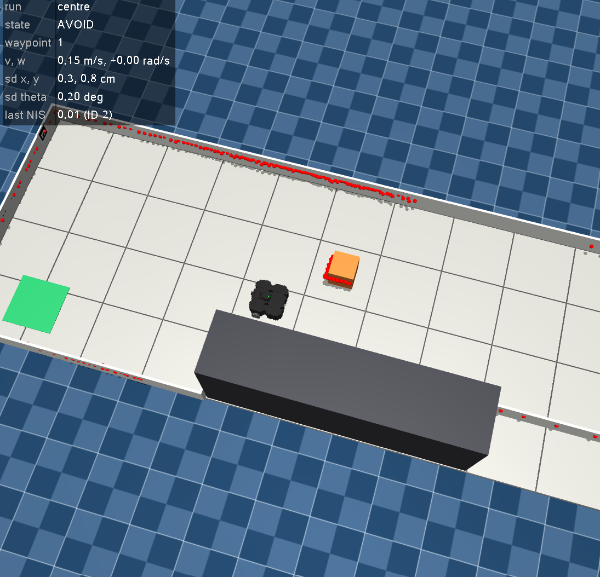
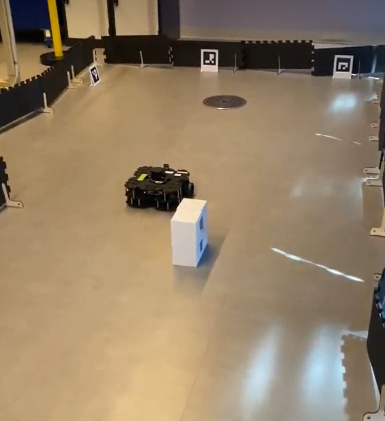
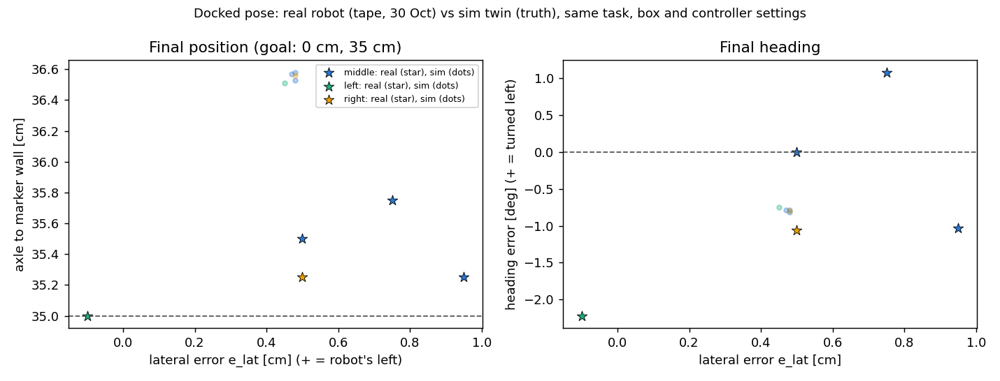
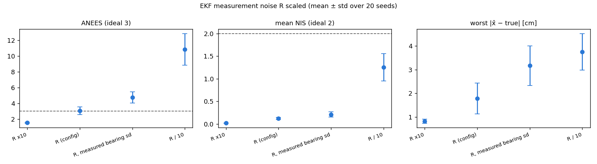
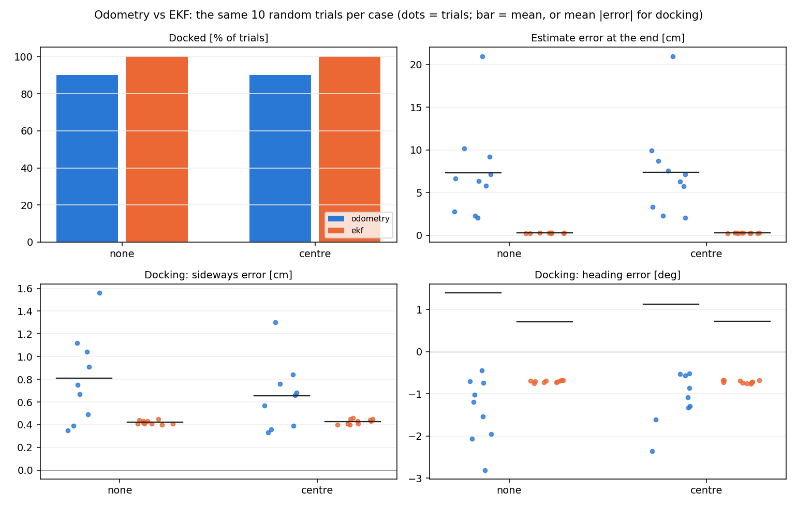

# SCMS Track A Project (Team 12)

## 1. Overview
**Task**

This is Track A, a mobile robot. This task has a TurtleBot navigating a room of obstacles to reach its ArUco-marked charging station. This task has been performed both in MuJoCo and in real life. Utilising: 
- 2D LiDAR
- Camera
- Wheel-encoder odometry
This task’s constraint is that the controller must use the estimated state, never the ground truth

**pipeline diagram**

I.O.U

**simulation**



**hardware appliance**




** What is beyond the coursework?*


** Simulation vs. Real Robot Results **


**Marker's Guide**


**repo:**
(https://github.com/Atomic-add/SCMS_IntegratedProject.github.io.git)

**video link**
INSERT VIDEO


## 2. Modelling (A): state-space model, controllability and observability analysis


## 3. Sensing (B): calibration, noise handling and frame management


## 4. Estimation (C): EKF design, tuning and reported performance

### 4.1 EKF design
The estimation section is adapted from **Week 7 C.3 / C.4**, and **Assessment 3, Task B.3**, borrowing the following variables:
- ekf_predict
- ekf_update
- F_uni
- h_rb
- H_rb
- Qd reasoning

The design has 2 main functions: predict and update.

**Predict** is generated once per new encoder sample. Utilised to move the estimate with the wheel increments and grow P by the wheel noise. 

**Update** is generated once per new camera frame. This fuses one marker's range and bearing, and returns its NIS.

### 4.2 Tuning: Q, R and P0, and where each value comes from [D]

- **Q (process noise)**: This refers to uncertainty in the motion prediction at each step. This includes wheel slip and radius error, which grows with the distance travelled.
  
- **R (sensor noise)**: These are random, unwanted variations of the sensor's output. Affecting the accuracy and reliability of measurements

- **P0 (starting uncertainty)**

The table below is an expansion upon these 3 variable groups. Illustrating what each variable belongs to, and what it does.

|  Group   |    Variable     |                    What it is                    |
| :------- | :-------------- |  :---------------------------------------------- |
|   Q      | k_wheel         | Wheel error, which grows with distance travelled |
|          | q_floor         | noise, which is added to Qd every step. Keeps P  |    
|          |                 | positive                                         |
|   R      | range_sd [a,b]  | range noise = a + b*r^2                          |
|          | bearing_sd_deg  | bearing noise                                    |
|          | range_bias_r2   | Known camera range bias.                         |
|   P0     | P0_sd           | Starting uncertainty: x, y, heading              |    

All variables listed come from ([estimation.json](config/estimation.json))

### 4.3 Reported performance

To begin, below is a simple pass/fail check from ([estimation_test.py](src/estimation/estimation_test.py)). This serves as a quick and efficient method of checking whether it is able to pass everything or not in a simulated environment.

-----------------------------------------------------------------------------------

PASS  baseline: the first encoder sample does not move the estimate

PASS  straight: equal wheel turns move 1 m along x, heading unchanged

PASS  turn: opposite wheel turns spin +90 deg on the spot

PASS  repeated encoder timestamp: no second prediction

PASS  wrap: 179 deg - (-179 deg) is -2 deg, not 358 deg

PASS  bearing residual is wrapped near +-180 deg   (bearing 1.57 deg)

PASS  F matches finite differences

PASS  H matches finite differences

PASS  missing data: empty markers dict leaves the estimate unchanged

PASS  missing data: unknown ID 7 leaves the estimate unchanged

PASS  missing data: nan measurement leaves the estimate unchanged

PASS  repeated frame: fused once only

PASS  old frame (1 s behind the encoders): not fused

PASS  correction: 11 cm / 3 deg off, markers 0 and 2 in view -> below 1 cm and 0.5 deg   (0.63 cm, 0.23 deg, 58/58 fused)

PASS  gate: a 1 m range outlier is rejected   (NIS 311)

PASS  1000 random steps: x_hat finite, P symmetric, eigenvalues >= 0   (min eig 1.9e-04)

PASS  config: by default the sim camera's ekf_noise replaces range bias, range sd and bearing sd   ({'range_bias_r2': 0.0045, 'range_sd': [0.00911, 0.00563], 'bearing_sd_deg': 0.0571})

PASS  config: the real camera's range_correction drops the sim bias (never subtracted twice)

0 failed - all checks passed

------------------------------------------------------------------------------------

INSERT RUN DEMO OUTCOMES

### 4.4 Tuning trade-off

This runs a test to compare Consistency to Responsiveness. It scales the EKF's measurement noise (R). Watch NEES, NIS, and the error.



These test results are from ([sweep_r](evaluation/sweep_r.py)). Modified with AI to improve readability.

|R                      |	Docked | ANEES      |	NIS	|Gated|	Worst error [cm] |
| :-------------------- | :----- | :--------- | :-- | :-- | :--------------- |
|R x10	                |  100 % |1.54 ± 0.06	|0.02 |0.0  |	0.82 ± 0.08      |
|R (config)	            | 100 %	 |3.08 ± 0.49 |0.12 |0.2  |	1.78 ± 0.65      |
|R, measured bearing sd |	100 %	 |4.76 ± 0.70 |0.21 |0.6  |	3.17 ± 0.83      |
|R / 10	                | 100 %	 |10.85 ± 1.99|1.25 |12.0 |	3.75 ± 0.78      |

### 4.5 Comparison with 2nd estimator
This compares the EKF to odometry through 20 random tests. Observing through simulation if it could dock successfully

| Run | Docked | Contacts | Notes |
|---|---|---|---|
| EKF | 20 / 20 | 0 | 42.0 +- 1.9 s, dock lateral 0.23 +- 0.44 cm, yaw -0.37 +- 0.76 deg, ANEES 3.8; seed 5 (box beside the lane) used to stop `too_close` on its narrow side; the pass side is now the one needing the smaller sideways offset (`avoidance.py`) |
| Odometry only | 9 / 20 | 2 | the hidden placement and wheel errors are never corrected (estimate off by up to 74 cm) |

To expand upon this, ([run_demo](evaluation/run_demo.py)) was utilised to create a graph. This showcases how not only does the EKF have a higher docking rate, but also its errors are more consistently close to 0. In comparison to the odometry readings. With very inconsistent errors



From these 2 points, it is made clear that the EKF outperforms the odometry as an estimator. Not only has a higher success rate of docking. But also producing fewer errors.


## 5. Control (D): controller design, tuning and tracking results


## 6. Integration and Robustness (E): performance under disturbance and noise


## 7. Real Robot


## 8. Independent Contribution Summary (only list what has results) Core (needed):


## 9. Limitations and Lessons
### What the results do, and don't support

### What failed during development, and how was it diagnosed?


## 10. Reproducibility

### Install and run from a fresh environment

#### 1. Set up (once per computer)

You need **Python 3.10** (64-bit) and **Git**. Each member creates their own virtual environment
`.venv_mujoco` inside the project folder; it is never committed.

##### Linux (Ubuntu)

```bash
git clone https://github.com/Atomic-add/IntegratedProject_SensorsAndControlsForMechatronicSystems_SPR2026.git
cd IntegratedProject_SensorsAndControlsForMechatronicSystems_SPR2026
python3.10 -m venv .venv_mujoco            # Ubuntu: sudo apt install python3.10-venv if this fails
source .venv_mujoco/bin/activate
python -m pip install --upgrade pip
python -m pip uninstall -y opencv-python  # only matters if it was installed before ("Skipping" is fine)
python -m pip install -r requirements.txt
```

##### Windows (PowerShell)

```powershell
git clone https://github.com/Atomic-add/IntegratedProject_SensorsAndControlsForMechatronicSystems_SPR2026.git
cd IntegratedProject_SensorsAndControlsForMechatronicSystems_SPR2026
py -3.10 -m venv .venv_mujoco
.\.venv_mujoco\Scripts\Activate.ps1
python -m pip install --upgrade pip
python -m pip uninstall -y opencv-python
python -m pip install -r requirements.txt
```

If PowerShell blocks `Activate.ps1`, skip activation and call the environment's Python directly,
e.g. `.\.venv_mujoco\Scripts\python.exe main.py`. More detail: `mujoco_installation_guide/`.

##### Check the installation

```bash
python -c "import sys, mujoco, cv2; print(sys.version.split()[0], mujoco.__version__, cv2.__version__)"
```

Expected: `3.10.x 3.15.0 4.10.0`.

`requirements.txt` pins every package (cp310 wheels exist for Windows and Linux):
mujoco 3.15.0, numpy 2.2.6, scipy 1.15.3, matplotlib 3.10.9, spatialmath-python 1.1.18,
opencv-contrib-python 4.10.0.84 (the Week 3 pin). Never install `opencv-python` next to it: both
provide `cv2` and break each other. After a `git pull` that changes `requirements.txt`, run the
install line again.

**Every time** you open a new terminal: go to the project folder and activate the environment
(`source .venv_mujoco/bin/activate` or `.\.venv_mujoco\Scripts\Activate.ps1`).

#### 2. Run the demo

The same commands work in a Linux terminal and in Windows PowerShell:

```bash
python main.py                      # the lab track as built in the lab: centre box, EKF, lab camera, viewer
python main.py --case none          # obstacle case: none | left | centre | right
python main.py --odometry           # steer on wheel odometry only (the baseline, no EKF)
python main.py --seed 3             # another sensor-noise seed
python main.py --no-camera          # MuJoCo viewer only
python main.py --headless           # no windows, prints the result only
python main.py --randomise --seed 7 # random lab scenario: route, start placement, box, noise, wheel error
python main.py --dock pbvs          # dock on the LQR all the way instead of finishing with IBVS
```

**Docking and visual servoing.** From W3 (the pre-dock point) the LQR (EKF heading, camera position) puts the robot on the
marker's normal; below 0.55 m the last part is **image-based visual servoing** (Week 9,
`src/control/visual_servo.py`): (v, omega) = lambda J_mr^+ (p* - p) on the four marker corners, with the
image Jacobian reduced to what the base can do and corrected for the camera sitting 7.6 cm ahead of the
axle. In the camera window the docking marker (ID 0) is outlined in green with its axes and its
position in the camera frame; the EKF's landmark markers are outlined in yellow. `python -m evaluation.check_ibvs` compares IBVS and
PBVS docking on the same seeds -> `results/ibvs_docking.png`.

`--randomise` (`src/robot/scenario.py`): the robot is **told** a new start spot (its EKF prior) and a new
route (the start spot within 0.15 m and 15 deg of the red dot, W1 and the corner W2 within 0.15 m and
0.1 m); it is **not told** where it was really placed (drawn from N(0, P0)), where the box is (always
inside its lane on the long leg, x 1.75-3.0 m, with one side at least 0.7 m wide), how noisy the LiDAR and camera are, or how wrong each wheel radius is.
The terminal prints both halves. In the viewer the red dots are the LiDAR returns placed with the EKF
estimate, and the panel shows the state, the commands, the sd from P and the last NIS.

Linux without a display (SSH, CI): `MUJOCO_GL=egl python main.py --headless` (`--headless` sets
`MUJOCO_GL=egl` itself when it is not set).

What happens: without `--task` the sim is `config/arena_lab.json`, the lab floor as the robot will meet
it (0.5 m tiles, panels, the 20 cm box, three markers, the LDS-01 range and the lab robot's camera:
f 692 px, 49.7 x 38.2 deg, 6.3 deg down, 30 Hz, calibrated into `config/camera_sim.json`). The robot starts from the task file's prior, follows the
waypoints with the LQR, goes around the box with the LiDAR, turns left at the far end and docks at the
charging station (marker ID 0). The terminal prints each state change (TRACK, AVOID, REJOIN, DOCK, STOP)
and finally, for example:

```
result: docked after 46.0 s of sim time, dock_complete = True
```

The exit code is 0 when the robot docked and 1 otherwise. In the viewer the red dots are the LiDAR
returns placed with the EKF estimate (if the estimate drifts, the dots slide off the walls) and the
top-left panel shows the state and the commands. The **robot camera** window outlines every ArUco
marker it sees, with the range and bearing that perception hands to the EKF. Close the viewer to exit.
Viewer: left-drag rotates, right-drag pans, scroll zooms, Tab / Shift+Tab hide the panels.

##### The lab track and the real TurtleBot

The lab floor (10 x 4 tiles of 0.5 m) has its own task file, `config/arena_lab.json`, and scene,
`models/robotis_tb3/scene_lab.xml`; `config/stage1_dock.json` (dock only) and `config/stage2_corner.json`
(left turn + dock) reuse it through `"extends"`. The same file runs in the sim and on the robot:

```bash
python main.py                                                # the lab track in the sim
python main.py --task config/stage1_dock.json --case none     # one stage in the sim
python experiments/plot_setup.py                              # layout sheet -> results/setup_arena_lab.png
```

The sim camera is the MJCF camera `rgb`, calibrated into `config/camera_sim.json`
(`python experiments/calibrate_camera.py`, which holds the board along the 6.3 deg tilt). It has no lens
distortion and no range bias, and its pixel noise is still the 2.0 grey-level placeholder. Its marker
noise for the EKF (`ekf_noise`) was fitted by `evaluation/consistency_sweep.py --write-noise`.

The real robot uses `src/robot/real_robot.py` (`RealRobot`, the same interface as `SimRobot`) over the
lab's rosbridge (UTS-RI/turtlebot_rosbridge). Install it once, after `requirements.txt`:

```bash
python -m pip install -r requirements-real.txt
python -m pip install --no-deps "git+https://github.com/UTS-RI/turtlebot_rosbridge.git@8a6c481c506d1b817937d865af0d794ea0d45d51"
```

`--no-deps` matters: the package asks for `opencv-python`, which would remove `cv2.aruco`. In the lab
(laptop on the `turtlebot-MMR` wifi, robot IP `192.168.1.2XX`, default in `config/robot_real.json`):

```bash
python experiments/check_robot.py 192.168.1.2XX --drive          # topics, joint names, scan layout, 10 cm drive
python experiments/capture_frames.py 192.168.1.2XX               # checkerboard frames -> results/hardware/calib
python experiments/calibrate_camera.py --images results/hardware/calib --out config/camera_real.json
python experiments/camera_pitch.py --write                       # camera tilt from ArUco frames -> camera_real.json
python experiments/aruco_real_noise.py --write                   # ArUco range bias + sd vs tape -> camera_real.json range_correction
python main.py --real --task config/stage1_dock.json             # then stage2_corner.json, then arena_lab.json
```

Wheel calibration (UMBmark, Week 2 B.3-B.4): `experiments/umbmark.py` drives 1 m squares on the encoders
only and asks for three tape readings (two rear chassis corners against an L of tape on the floor) before
and after each run; it fits the left/right wheel sizes and the true track width, `--straight` gives the
overall wheel scale, and the scatter left over gives `k_wheel`. Config files are not changed by it.

```bash
python experiments/umbmark.py --cw --runs 5        # right turns; then --ccw --runs 5, then --straight --runs 3
python experiments/umbmark.py --analyse 'results/hardware/umbmark_*.json'
```

Sim vs real (30 Oct): the docked pose of five real runs, taped at both wheels
(`results/hardware/final_pose_tape_30oct.csv`), against the same runs in the sim with the real control
overrides. Lateral error agrees within 0.6 cm and heading within 0.2 deg on average; the real robot stops
1.2 cm closer to the marker (its coast after the stop command, which `stop_early` compensates).

```bash
python -m evaluation.real_vs_sim      # -> results/real_vs_sim.png / .json
```

`--real` requires `--task`, caps the speed at `v_max` / `w_max` from `config/robot_real.json`, stops the
robot when `/joint_states` or `/scan` goes quiet, when the link drops, on Ctrl+C, or when a second robot
publishes on the same topics, and saves the run to `results/hardware/run_<time>.npz` (estimate, P,
commands, NIS). The robot's true end pose is measured by hand (tape from the dock panel).

#### 3. Checks

Before every merge, from the project root:

```bash
python -m evaluation.check_rules             # ground-truth rule + unit checks + IBVS checks, exit code 0 = all pass
python -m src.control.visual_servo           # Week 9 image Jacobian vs finite differences, IBVS loop on geometry
python -m src.estimation.estimation_test     # EKF and odometry unit checks
python -m src.control.control_test           # controller, avoidance and docking unit checks
python -m src.robot.real_robot_test          # RealRobot on a fake rosbridge link (no robot needed)
python -m src.estimation.observability_test # observability ranks per marker case, F_jac / H_rb vs numerical Jacobians
python -m src.control.lqr_weights_test      # LQR at R x10, x1, /10: K vs control.dlqr, Riccati residual, |eig| < 1
python main.py --headless                    # the lab track must dock (exit code 0)
python main.py --headless --randomise --seed 7   # and so must a random lab scenario
```

After changing anything in `models/`, `src/robot/` or `src/perception/`:

```bash
python experiments/make_textures.py      # marker and checkerboard images (scenes need them)
python experiments/calibrate_camera.py   # camera K from checkerboard views -> config/camera_sim.json
python evaluation/check_lidar.py         # expect 6/6 checks passed -> results/lidar_check.png
python evaluation/check_camera.py        # expect 8/8 checks passed (1-2 min) -> results/camera_check.png
python evaluation/drive_square_test.py --no-viewer   # odometry around a 0.5 m square, graded on truth
```

Headless Linux (no display): prefix with `MUJOCO_GL=egl`, e.g. `MUJOCO_GL=egl python evaluation/check_camera.py`.


### Commands to regenerate each figure and table


### Ground truth rule
The controller must use the estimated state, never the ground truth. Ground truth can only be read in evaluation/


## 11. Team and Declarations 
### Group Number and Team members
**TEAM 12**
- Addison Possamai (25840164)
- Nguyen Kim Uyen Phan (25596519)
- Nhat Thien Mai (25161391)

### Individual contributions

|   Task                             | Person          |
| :--------------------------------- | :-------------- |
|    Overview                        | Addison         | 
|    Modelling (A)                   | Kim             | 
|    Sensing (B)                     | Thien           | 
|    Estimation (C)                  | Addison         | 
|    Control (D)                     | Kim             | 
|    Integration and Robustness (E)  | Kim             | 
|    Real Robot                      | Thien           |
|    Independent Contribution Summary| Kim             | 
|    Limitations and Lessons         | Addison         | 
|    Reproducibility                 | Addison         | 

### Generative AI declaration
**Claude (Anthropic)** was used to scaffold the simulation environment, the sensor
models and their checks; see the project page's GenAI declaration.

### Acknowledgements
- Robot model and meshes: [ROBOTIS robotis_mujoco_menagerie](https://github.com/ROBOTIS-GIT/robotis_mujoco_menagerie),
  Apache-2.0 (`models/robotis_tb3/LICENSE`); sensor poses from ROBOTIS `turtlebot3_waffle_pi.urdf`.
- Code adapted from the 41014 Week 2-9 tutorial solutions (cited in each module's docstring).
- Real-robot link: [UTS-RI/turtlebot_rosbridge](https://github.com/UTS-RI/turtlebot_rosbridge) (`rosbridge_api`,
  MIT), used unmodified; `src/robot/real_robot.py` hooks its message callbacks to keep arrival times.
