# Track A project page structure (final)

## GROUP NUMBER / TEAM MEMBERS
**TEAM 12**
- Addison Possamai (25840164)
- Nguyen Kim Uyen Phan (25596519)
- Nhat Thien Mai (25161391)

## 1. Overview
### 1.1 Task, platform, the rule that the controller uses the estimated state only, plus repo and video links [D]

This is Track A, a mobile robot. This task has a TurtleBot navigating a room of obstacles to reach its ArUco-marked charging station. This task has been performed both in MuJoCo and in real life. Utilising: 
- 2D LiDAR
- Camera
- Wheel-encoder odometry
This task’s constraint is that the controller must use the estimated state, never the ground truth

**repo:**
(https://github.com/Atomic-add/SCMS_IntegratedProject.github.io.git)

**video link:**
(INSERT VIDEO)


### 1.2 Pipeline diagram, simulation and real-robot photos [D]

**pipeline diagram**

I.O.U

**simulation**

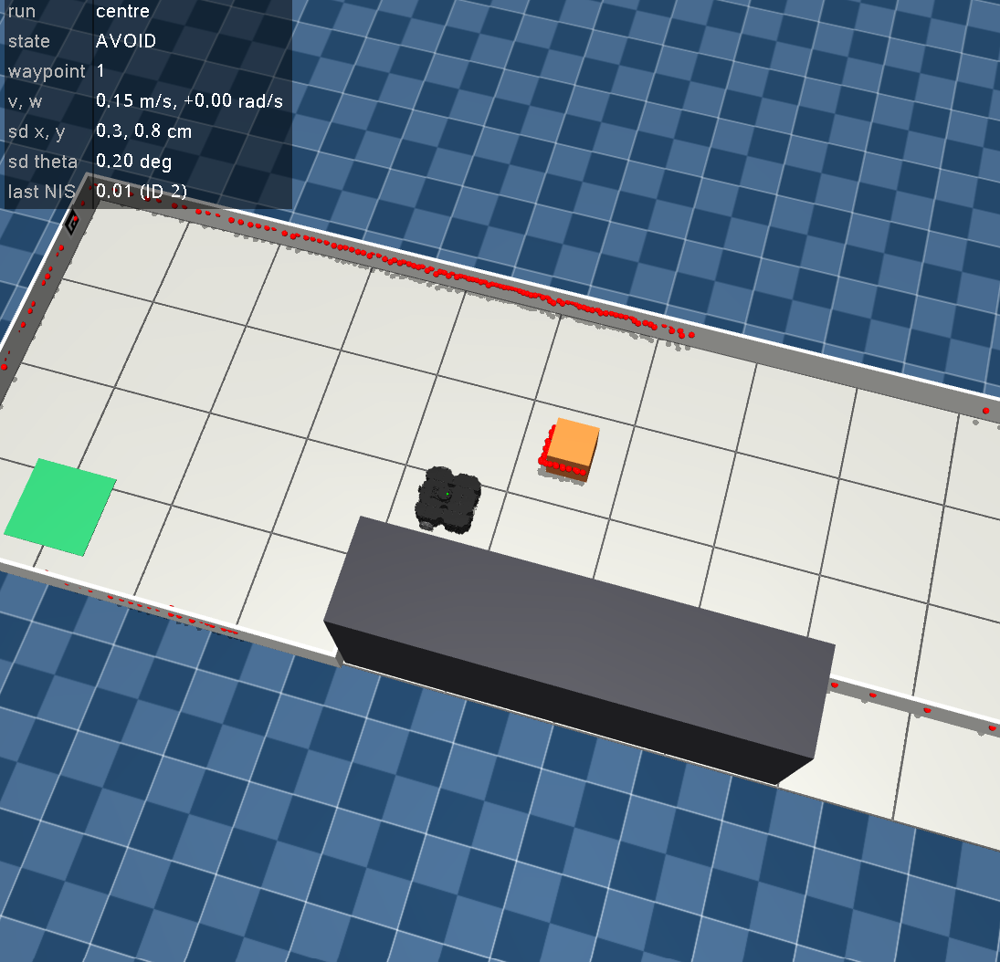

**hardware appliance**

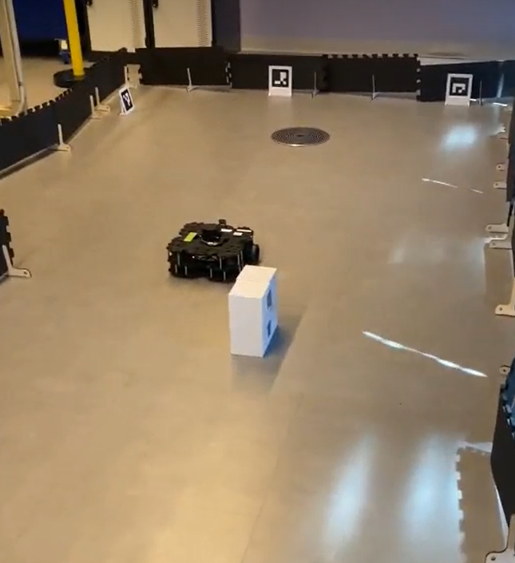


### 1.3 What is new beyond the coursework (Assessment 3 covered path-error LQR/LQI and a range-only EKF): range+bearing ArUco EKF, LiDAR avoidance, IBVS docking, randomised trials, real robot [D]


### 1.4 Headline results: simulation vs real robot [HD]

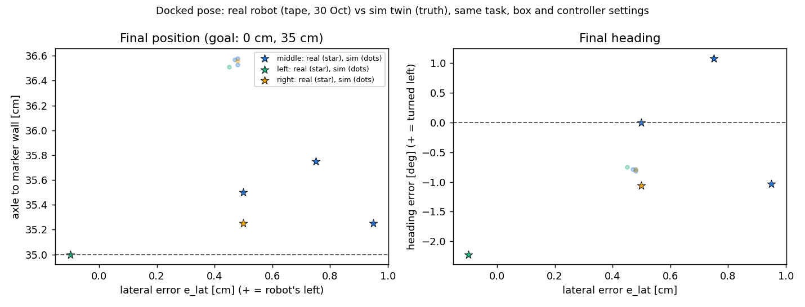

### 1.5 Marker's guide: where each criterion is evidenced, plus video timestamps for the task completed, a disturbed trial, and the estimate with uncertainty vs ground truth [D]


## 2. Modelling (A): state-space model, controllability and observability analysis
### 2.1 State-space model: derived for the TurtleBot3, with stated assumptions [D]
**Error dynamics:** Path following regulates the error to the path. With cross-track error e<sub>y</sub>, heading error e<sub>θ</sub> and curvature κ, the error dynamics are (A3 A.1)

$$\dot e_y = v\sin e_\theta, \qquad \dot e_\theta = \omega - \frac{v\kappa\cos e_\theta}{1-\kappa e_y}$$

**Linearisation:** Substituting ω = vκ + δω and writing the error dynamics above as ė = f(e, δω), A and B are the Jacobians of f at the operating point e = 0, δω = 0 (W5):

$$A = \left.\frac{\partial f}{\partial e}\right|_{e=0}, \qquad B = \left.\frac{\partial f}{\partial\,\delta\omega}\right|_{e=0}$$

```math
\dot e = \begin{bmatrix}0 & v\\ -v\kappa^2 & 0\end{bmatrix} e + \begin{bmatrix}0\\ 1\end{bmatrix}\delta\omega
```

On the lab's straight segments κ = 0, so A = [[0, v], [0, 0]] and B = [0, 1]: v sits inside A, and at v = 0 the robot cannot steer out a lateral error.

**Discretisation:** The controller runs every T<sub>s</sub> = 0.05 s and holds each command until the next, so the model is discretised with a zero-order hold:

$$A_d = e^{AT_s}, \qquad B_d = \int_0^{T_s} e^{A\tau}B\,d\tau$$

Because A² = 0 on a straight, the series e<sup>AT<sub>s</sub></sup> = I + AT<sub>s</sub> + (AT<sub>s</sub>)²/2 + … stops after two terms, so the result is exact:

```math
A_d = I + AT_s = \begin{bmatrix}1 & vT_s\\ 0 & 1\end{bmatrix}, \qquad e^{A\tau}B = \begin{bmatrix}v\tau\\ 1\end{bmatrix} \;\Rightarrow\; B_d = \begin{bmatrix}vT_s^2/2\\ T_s\end{bmatrix}
```

At v = 0.2 m/s:

```math
A_d = \begin{bmatrix}1 & 0.01\\ 0 & 1\end{bmatrix}, \qquad B_d = \begin{bmatrix}0.00025\\ 0.05\end{bmatrix}, \qquad e[k+1] = A_d\,e[k] + B_d\,\delta\omega[k]
```

Steering changes e<sub>θ</sub> directly (T<sub>s</sub> = 0.05 per unit δω), but moves e<sub>y</sub> only by turning the heading first, with coupling vT<sub>s</sub> = 0.01, so the authority over e<sub>y</sub> shrinks with speed and vanishes at v = 0.

**Assumptions:** Kinematics only (no slip, no motor lag), constant v, small errors (checked in 2.4), nominal track width 288 mm (UMBmark: 292.6 mm). The controller sees only the EKF estimate.

**Open-loop behaviour:** On a straight, the open loop has a repeated eigenvalue at z = 1, so it is unstable: a constant heading error makes e<sub>y</sub> grow linearly. Our lab path is straight segments (κ = 0) with corners turned on the spot, but to check the model on a curve we also test an arc of R = 0.5 m (κ = 2 /m). There the eigenvalues are s = ±j vκ = ±0.4j rad/s (on the unit circle in z), so it is marginally stable but not asymptotically stable. Feedback is needed in both cases, and because v sits inside A, everything below depends on speed.

### 2.2 Controllability analysis [D]
With A = [[0, v], [0, 0]] and B = [0, 1] from 2.1 (on a straight), C = [B AB] = [[0, v], [1, 0]], so det C = −v.

| Speed | Rank of C | det C |
|---|---|---|
| 0.20 m/s (cruise) | 2 | −0.20 |
| 0.05 m/s (docking) | 2 | −0.05 |
| 0 (turn on the spot) | **1** | 0 |

**Interpretation:** Controllable at every speed except zero: at v = 0, the only path from steering to e<sub>y</sub> (ė<sub>y</sub> = v e<sub>θ</sub>) is cut, so rank C drops to 1. This is the nonholonomic constraint: the robot cannot move sideways.

The rank test only says whether the system is controllable, not how easy it is to control. The singular values of C are 1 and v (calculated in the code). Therefore, slow driving is weakly controllable, not uncontrollable. So, the LQR is used only when the robot is driving on a straight. At the corners, the robot stops and turns on the spot with a P-controller, as e<sub>θ</sub> stays controllable at v = 0.

### 2.3 Observability analysis, including marker lost [D] MISSING
**Measurement:** The EKF measures range and bearing to each marker centre, not the full ArUco pose, so each marker in view adds two rows to the measurement Jacobian H<sub>k</sub>. The pose has three states, (x, y, θ).

**Rank test:** A linear model with sensor matrix C (y = Cx) is observable when the observability matrix has full rank:

```math
\mathcal{O} = \begin{bmatrix}C\\ CA\\ \vdots\\ CA^{n-1}\end{bmatrix}, \qquad \mathrm{rank}(\mathcal{O}) = n
```

In the EKF, the measurement Jacobian H<sub>k</sub> and the motion Jacobian F<sub>k</sub> change every frame, so the same idea is applied to the linearised EKF, frame by frame. A small error δx<sub>0</sub> in the initial pose changes each frame's predicted measurement by:

$$\delta z_0 = H_0\,\delta x_0, \qquad \delta z_1 = H_1F_0\,\delta x_0, \qquad \delta z_2 = H_2F_1F_0\,\delta x_0, \ \dots$$

Stacking these gives

```math
\begin{bmatrix}\delta z_0\\ \delta z_1\\ \delta z_2\\ \vdots\end{bmatrix} = \mathcal{O}_N\,\delta x_0, \qquad \mathcal{O}_N = \begin{bmatrix}H_0\\ H_1F_0\\ H_2F_1F_0\\ \vdots\end{bmatrix}
```

If rank(O<sub>N</sub>) = 3, any small pose error δx<sub>0</sub> shows up in the measurements, so the pose is locally observable along that trajectory.

The rank says whether the pose is recoverable, and the null space shows what stays hidden. Test pose (1.5, 1.25) m on the lab lane, 1 s = 20 frames ([observability.py](evaluation/observability.py), results in [observability.json](results/observability.json)).

| Markers in view | Rank, 1 frame | Rank, 1 s driving | Hidden direction |
|---|---|---|---|
| none | 0 | 0 | everything (not detectable) |
| one | 2 | 2 | rotation about the marker |
| two | 3 | 3 | none |

**Marker lost:** With no marker in view, the EKF only predicts:

$$P_{k+1} = F_kP_kF_k^T + Q_d$$

From the converged P, the position standard deviation σ (worst horizontal direction) grows with every prediction step. If the robot kept driving at 0.2 m/s, the 3σ bound would pass the 3 cm dock tolerance after 3.5 s (0.7 m).

**Interpretation:** One marker gives two measurements, range and bearing, but the pose has three states, so one direction is always missing. That direction is a rotation of the robot about the marker: every pose on a circle around the marker, with the heading turned by the same angle, gives the same range and bearing. Odometry only measures motion in the robot's own frame, so the same run started anywhere on that circle gives the same measurements and the same wheel counts, and the rank stays 2.

A second marker at a different place breaks the circle and results in rank 3. This works whether both markers are seen at the same time or one after the other, with odometry linking the two views.

With no marker, nothing is measured and the error drifts instead of decaying, so the pose is not even detectable. Driving blind would let the 3σ bound pass the 3 cm tolerance after about 3.5 s, so docking never drives without a marker. It stops at once, waits for the marker, and declares failure if none returns within 3 s ([docking.py](src/control/docking.py), `marker_lost_timeout` = 3 s in [control.json](config/control.json)).

### 2.4 Model correctness: where the model breaks down and what that costs, e.g. closed-loop eigenvalues vs speed (adapt Assessment 3 D.4) [HD] (A has no hardware credit, so this is A's HD)
The robot was run at three speeds without redesigning K (20 runs each, [model_limits.py](evaluation/model_limits.py)). For δω = −(k<sub>y</sub> e<sub>y</sub> + k<sub>θ</sub> e<sub>θ</sub>) on a straight, the closed-loop poles satisfy:

$$\lambda^2 + k_\theta\lambda + k_y v = 0$$

so they depend on v. The decay time shortens 3.5 times from 0.10 to 0.26 m/s (3.2 to 0.92 s), but the distance over which an error decays changes much less, from 0.32 to 0.24 m.

| Speed | Slow pole \|z\|, straight / test arc (R = 0.5 m) | S1 cross-track RMS | NEES ≤ 7.81 | Docked |
|---|---|---|---|---|
| 0.10 m/s | 0.985 / 0.984 | 1.65 cm | **89 %** | 20 / 20 |
| 0.20 m/s (design) | 0.965 / 0.960 | 1.73 cm | 96 % | 20 / 20 |
| 0.26 m/s (top speed) | 0.947 / 0.933 | 1.80 cm | 99 % | 20 / 20 |

<p align="center">
  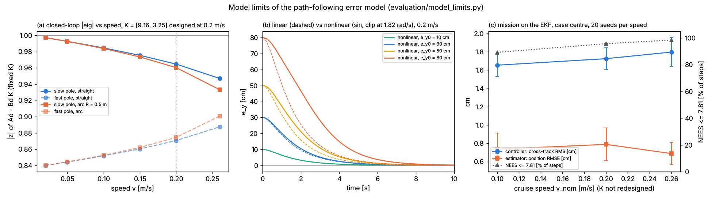
  <br><em>Closed-loop poles, linear vs nonlinear response, and tracking and NEES against speed.</em>
</p>

**Linear vs nonlinear:** Both models start from the same lateral offset at 0.2 m/s on a straight, with the same K. The nonlinear model uses sin e<sub>θ</sub> and clips ω at the robot's 1.82 rad/s (same script; values in [model_limits.json](results/model_limits.json), "validity").

| Initial offset | Peak command | Peak heading error | Linear vs nonlinear gap |
|---|---|---|---|
| 5 cm (maximum in the full runs) | 0.46 rad/s | 6° | 0.13 % |
| 20 cm | 1.83 rad/s (limit reached) | 26° | 1.2 % |
| 50 cm | 4.6 rad/s (clipped) | 64° | 12 % |

In the full runs, the cross-track error peaks at about 5 cm (5.2 cm in the worst of 60 runs), well inside the range where the linear model holds. The gap grows steadily with the offset (3.7 % at 30 cm) and becomes significant from about 50 cm, where the command is clipped at 1.82 rad/s and the heading error is too large for sin e<sub>θ</sub> ≈ e<sub>θ</sub>. This test covers only these two effects; the effects listed below can cause errors at any offset.

**Interpretation:**

- **Controller: robust to speed.** An error is always corrected over roughly the same distance, so tracking RMS rises only 9 % from 0.10 to 0.26 m/s. The same K works at every tested speed without redesigning.
- **Estimator: the first component to breach the A3 specification, at low speed.** A3's S4 requires at least 90 % of samples to have NEES ≤ 7.81, the 95th percentile of χ²<sub>3</sub>; a consistent filter would give about 95 %. Position RMSE does not change with speed (0.74, 0.79, 0.69 cm), but at 0.10 m/s NEES coverage falls to 89 %, below A3's 90 %, so the filter is overconfident. A likely cause, not yet tested on its own, is that Q<sub>d</sub> (process noise covariance) was tuned around the design speed and does not grow enough at low speed, so the filter becomes overconfident.
- **What the model leaves out.** The linear model ignores the per-wheel speed limit (saturation), camera latency (lag) and a +0.6 cm steady offset (persistent error). An LQI could remove an offset caused by an outside disturbance. However, if the EKF estimate itself is biased, the LQI cannot remove that offset, as it integrates the estimated e<sub>y</sub> and sees no error to correct.

## 3. Sensing (B): calibration, noise handling and frame management
The robot in this project uses three sensors including: wheel envodeer, a camera, and a LiDAR. Both the [simulator](src/robot/sim_robot.py) and the [real robot](src/robot/real_robot.py) read sensor data through the same three functions: read_encoders(), read_image() and read_scan(), with the real robot sends its data through rosbridge. These functions are used in both the simulator and the real robot to be processed using the same perception and estimation logic.  

- Wheel encoders (20Hz): provide wheel rotation measurements for odometry calulation, which then use for EKF to predict the robot's pose

- Pi camera (640 x 480 pixels, 20Hz): measures range and bearing to visible ArUco markers for EKF updates. Our track uses three markers from the DICT_4x4_50 dictionary, with a 100 mm side length. 

- LDS-01 LiDAR (360 beams, 1° interval, 5Hz): measures the free distance ahead, obstacle's edges and side clearances for obstacle avoidane
### 3.1 Calibration: camera, plus LiDAR validated against ray-cast truth 
Camera intrinsics: We calibrated both caemeras using a 9 x 6 checkerboard with 25 mm squares, ([calibrate_camera.py](experiments/calibrate_camera.py)). 

**Simulated camera**: In simulation, the board was palced at 20 random poses in front of the camera
<p align="center">
  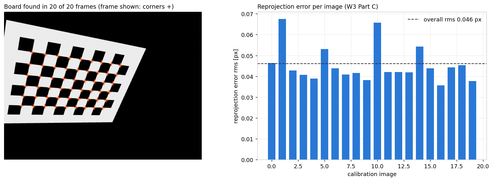
  <br><em>Simulated camera: board found in 20 of 20 frames.</em>
</p>
*Simulated amera: Board found in 20 of 20 frames*.

**Real camera**: For the real camera, the board was held by hand, trying different posision and angles in front of it. A set of 40 captured images were collected for calibration.
<p align="center">
  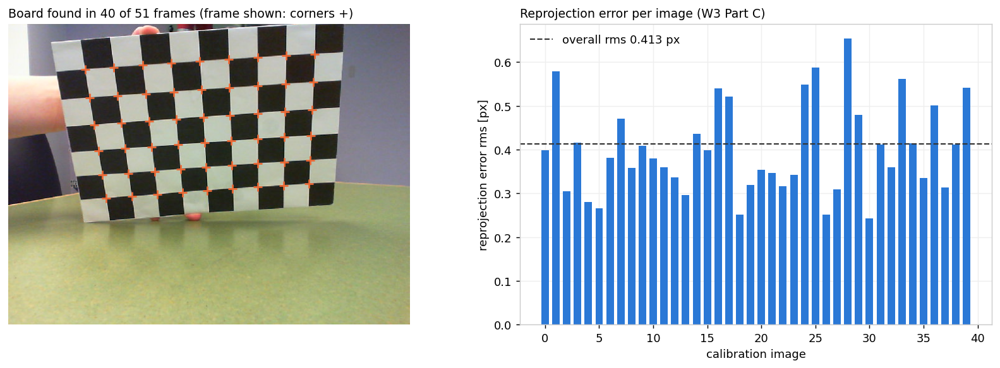
  <br><em>Real camera: board found in 40 of 51 captured images; those 40 were used for calibration.</em>
</p>

*Real camera: Board found in 40 of 51 captured images, with thoes 40 images used for calibration*

These collected data was then used to estimate the camera matrix K and lens distortion. To assessed the calibration quality, reprojection error was used, with the table below compares the results from both cameras. 

| Parameter | Simulation | Real camera |
|---|---|---|
| Frames used | 20 / 20 | 40 / 51 |
| Reprojection RMS | 0.046 px | 0.41 px |
| Focal lengths f<sub>x</sub>, f<sub>y</sub> | 692.07, 692.01 px | 691.5, 692.3 px |
| Principal point (c<sub>x</sub>, c<sub>y</sub>) | (302.2, 245.2) px | (302.2, 245.2) px |

The estimated simulated camera were then also compared with the true value from Mujoco camera. The estimated focal lengths matched the true value (692.00 px) within 0.010 %.

**Camera mounting pose**: Both the simulated and real cameras use the URDF mounting position: 0.076 m forward and 0.103 m above the robot's base origin. For the real camera, we also estimated pose of the camera ([camera_pitch.py](experiments/camera_pitch.py)). Returning an estimation a downward tilt of 6.3 degree from 50 AruCO images taken at different distances with a fixed marker height ([camera tilt images data](results/hardware)). The simulation camera was then reconfigured with the same 6.3° tilt to match the real one. 

**Real-camera range correction**: To verify the camera distances measurement, we compared the raw AruCo range estimates with the reference distances ([aruco_real_noise.py](experiments/aruco_real_noise.py)). The camera overestimated rage by approximately 0.6mm +3.2% of the reference distance, therefore a correction for this offset and scale error are used by [aruco.measure()](src/perception/aruco.py) to correct each range estimate before it is passed to the EKF for real robot

**Simulated LiDAR validation**: To check whether our LiDar measurement, noise and dropout behaviour matched the configured model, we compared its range with reference distances calcualted by a seperate 2D ray caster using the same map geometry, at five poses on the robot route (([check_sensor_lab.py](evaluation/check_sensors_lab.py)), ray caster in [grouth_truth.py](evaluation/ground_truth.py)).
The result show that, tange-noise standard deviation was 9.95 mm, close to the configured 10 mm. The beam dropout rate was 1.01%, compared with the configured 1%
<p align="center">
  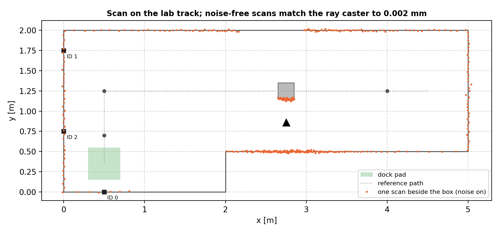
</p>

### 3.2 Noise handling: measured noise characterisation 


**Planar-pose ambiguity**:
We use ArUco range and bearing for the EKF correction measurement. This is because, for a flat marker viewed nearly straight on, IPPE can return two similar pose solution with different marker orientation. Therefore, we exclude the marker yaw and evaluate the range and bearing below. 

**ArUco measurement errors in simulation.**: 
We tested how ArUco range and bearing errors change with distance to check the EKF’s range-bias correction and measurement-noise settings in R<sub>n</sub>. This is done by using 20 frames with different robot poses then compare it with simulation grouth truth

The result showing that simulated camera tended to overestimate marker distance, with mean range errors of around 65 mm at 3 m and 131 mm at 4.5 m. Bearing bias remained below 0.02° at the tested poses. 
Because similar measurement accross consecutive frames can still share the same bias. consistent reading are not always accurate. To solve this, EKF first subtrach the know bias (4.5 mmr^2) and its range noise is set larger than the frame to frame spread to reduce it overcondident on repeated readings.  
<p align="center">
  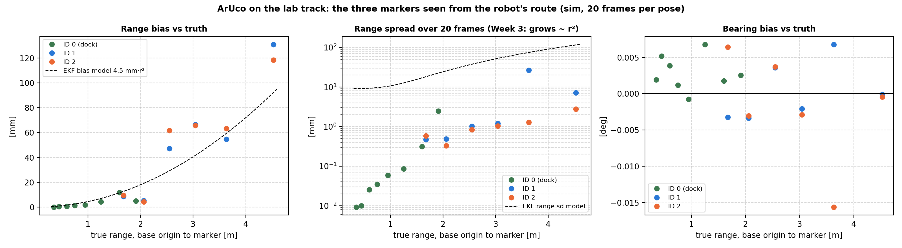
</p>

**Real-camera range measurements**:
We tested the camera range reading at seven different distance, keeping the robot and marker stationary between each distance. Between these trial, the range standard deviation across repeated image was 0.05-3.4 mm. We then used tape-measured distances as reference value and fitted a linear correction to the raw ArUco ranges using ([aruco_real_noise.py](experiments/aruco_real_noise.py)). This removes a fixed offset and adjust the range scale. After appying it, the mean diffeerence was within +- 3mm for the datasets used to fit the EKF correction. 
<p align="center">
  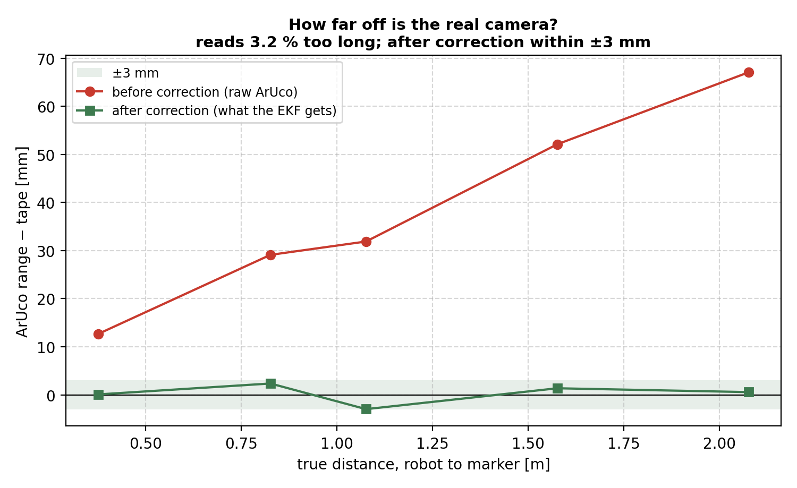
</p>

**Wheel-encoder evaluation**:
To evaluate the robot wheel odometry, we used [ubmmark.py](experiments/umbmark.py) to assess it errors. The robot drove 0.5 m squres three times in clockwise and counter-clockwise. With each run we measure the final position and heading errors. 

The result showing that a right to left wheel size ratio is 1.006 and a wheel seperation of 292.6 mm, compared with the nomina 288 mm. The wheel distance noise estimate was 5.2%, to include manual measurement error, we kepth k_wheel=6%. We kept the nominal wheel parameters and used Aruco updates to reduce pose drift. 
### 3.3 Noise handling: outlier rejection and marker-loss handling [D]

Before every measurements reaches the EKF, it need to passes the checks below. The robot also stop when the dock marker is unavailable during docking ([docking.py](src/control/docking.py)), or when LiDAR data return cover less than 80% in simulation or 20% on the real robot ([lidar_obs.py](src/control/lidar_obs.py)) 

<p align="center">
  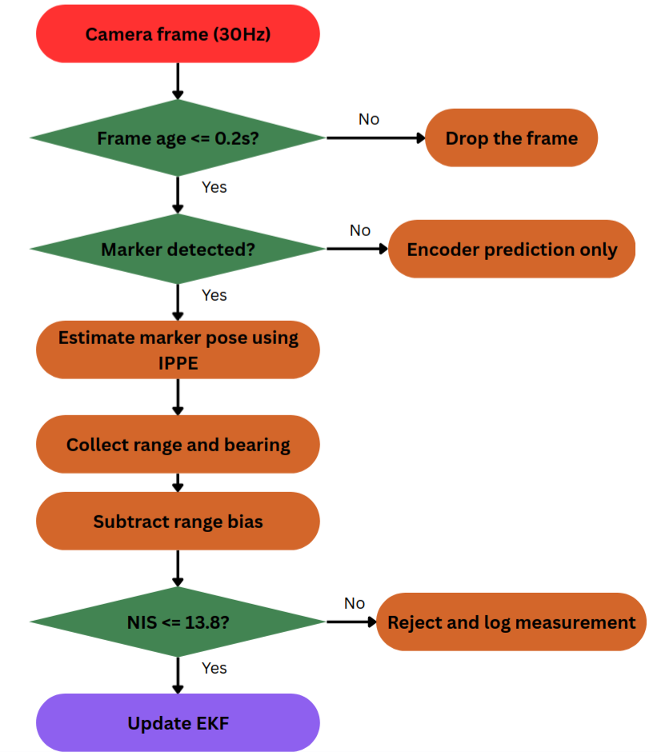
</p>

(Frame age, bias, NIS gate from [ekf.py](src/estimation/ekf.py)), 
(Detection, IPPE from [aruco.py](src/perception/aruco.py)).

**Real-robot validation**: To test our noise handling method on the real robot, we compared the marker 0 marker with it normal position and it have been moved. During a normal run, 96% of 1,092 marker measurement passed the NIS check. On the other hand 30 detections from the same marker exceeded the NIS threshold were rejected, while measurements from marker 1 and 2 still pass. The robot then waited 3 seconds and stopped with marker loss in this case 

<p align="center">
  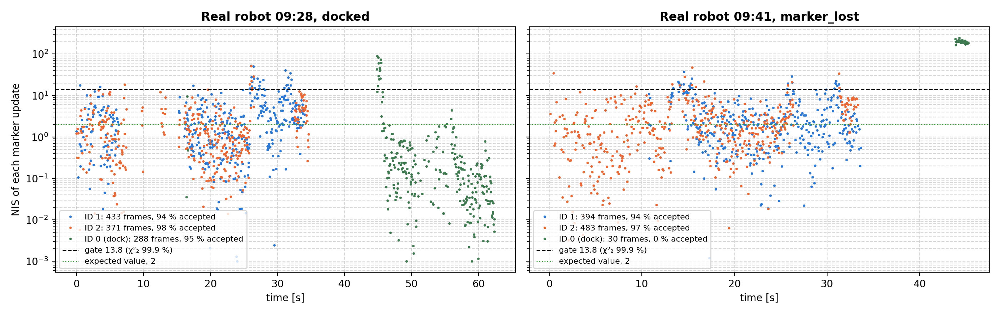
</p>
 
 **LIDAR data checks**: During tracking and obstacle avoidance, the robot stops if too few valid beams return in forward section.The real robot's Lidar coverage threshold was reduced from 80% to 20% because the lab's black foam panels using in the lab return very few to the LDS-01. However, this does not mean that obstacle detection's accuracy will be decreased, the box still triggered avoidance in all nine filmed runs ([lidar_obs.py](src/control/lidar_obs.py)). If a scan is more than 0.5 seconds old, the robot will also stops. 
### 3.4 Frame management: frame chain from sensor measurement to controller input [D]
<p align="center">
  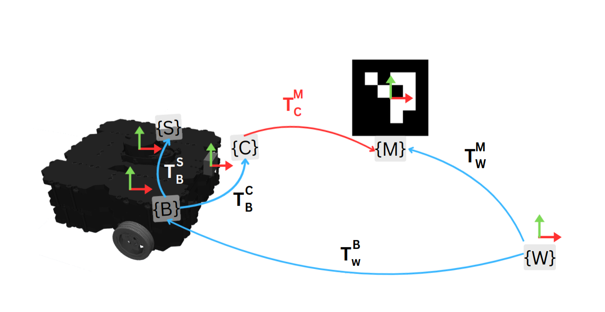
  <br><em>Blue: known or estimated transforms, Red: T<sub>C</sub><sup>M</sup>, measured every camera frame by ArUco + PnP.</em>
</p>

**Frame chain**: Camera and LiDAR sensors start their measurements in their own coordinate frames, {C} and {S}. We then use each sensor's mounting pose to calculated and transfer each sensor data to the robot's base frame {B}, centred between the two drive wheels T<sub>B</sub><sup>C</sup> or T<sub>B</sub><sup>S</sup>. Then, the EKF combines the marker range and bearing with the wheel encoders to estimate the robot pose T<sub>W</sub><sup>B</sup> in the map {W}, with the know marker poses T<sub>W</sub><sup>M</sup>. This estimate then used by the path tracker to compute the cross-track and heading errors, and the LiDAR points in {B} are used for obstacle avoidance. 
### 3.5 Simulated vs real sensor noise, and why they differ [HD-hw]
**Sensor performance: simulation vs real robot**

| Check | Simulation | Real robot | Why the different| 
|---|---|---|---|
|Camera calibration (reprojection RMS)| 0.046 px | 0.41 px | The simulated camera uses an ideal pinhole m. While real images involve lens distortion, board imperfection and hand-held board|
|ArUco range bias near 1 m| +1.8 mm | +33 mm raw, after correction +- 3 mm on fitted datasets|Residual calibration errors, tape measurement uncertainty may affect the result| 
|LIdar forward coverage| 88-100% | about 23% | The real LiDAR received fewer returns as a black foam panels|
|Wheel geometry| +- 0.1%|Right and left wheel ratio: 1.006, with wheel speration +1.6% relative to nominal value| Real tyres and assembly may introduce geometry differences |
## 4. Estimation (C): EKF design, tuning and reported performance
### 4.1 EKF design [D]

The estimation section is adapted from **Week 7 C.3 / C.4**, and **Assessment 3, Task B.3**, borrowing the following variables:
- ekf_predict
- ekf_update
- F_uni
- h_rb
- H_rb
- Qd reasoning

The design has 2 main functions: predict and update.

**Predict** is generated once per new encoder sample. Utilised to move the estimate with the wheel increments and grow P by the wheel noise. 

**Update** is generated once per new camera frame. This fuses one marker's range and bearing, and returns its NIS.

### 4.2 Tuning: Q, R and P0, and where each value comes from [D]

- **Q (process noise)**: This refers to uncertainty in the motion prediction at each step. This includes wheel slip and radius error, which grows with the distance travelled.
  
- **R (sensor noise)**: These are random, unwanted variations of the sensor's output. Affecting the accuracy and reliability of measurements

- **P0 (starting uncertainty)**

The table below is an expansion upon these 3 variable groups. It illustrates what each variable belongs to and what it does.

|  Group   |    Variable     | Value             |                   What it is                     |
| :------- | :-------------- | :---------------- |  :---------------------------------------------- |
|   Q      | k_wheel         |   0.06            | Wheel error, which grows with distance travelled |
|          | q_floor         |   1e-8            | noise, which is added to Qd every step. Keeps P positive |                                        
|   R      | range_sd [a,b]  | [0.003, 0.004]    | range noise = a + b*r^2                          |
|          | bearing_sd_deg  | 0.1               | bearing noise                                    |
|          | range_bias_r2   | 0.0055            | Known camera range bias.                         |
|   P0     | P0_sd           | [0.05, 0.05, 5.0] | Starting uncertainty: x, y, heading              |    

All variables listed come from ([estimation.json](config/estimation.json))

### 4.3 Reported performance: RMSE, NEES, NIS, ±3σ bounds [D]

To analyse and report the performance, ([run_demo.py](evaluation/run_demo.py)) is utilised. Running a simulated test of the robot and reporting back both its odometry and EKF. This will be further compared within 4.5

**RMSE (Root Mean Square Error)**: Reports the average distance between predicted values of the model and actual values.

**NEES (Normalised Estimation Error Squared)**: Utilised to evaluate the consistency of the Kalman filter. Through comparing the estimation error to the expected covariance of the estimator.

**NIS (Normalised Innovation Squared)**: Checks whether the Kalman filter's noise assumption aligns with the actual measurements.

**Odometry** 

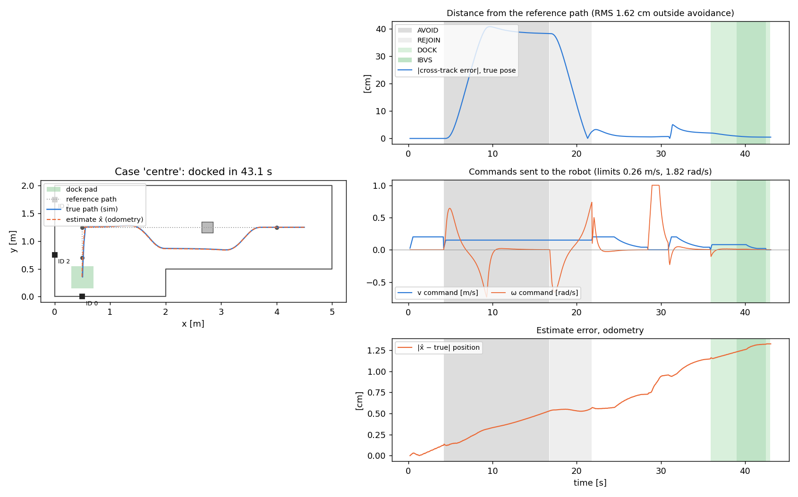

|   Case   | Docked | Time [s] | Cross-track RMS [cm] | RMSE [cm]  | Dock lateral [cm]| Heading [deg] | Collisions |
| :--------| :------| :--------| :--------------------| :--------- |:-----------------| :-------------| :----------|
|   none   | Yes    | 37.4     | 1.37                 | 1.16       | +0.7             | -1.1          | None       |
|   left   | Yes    | 37.2     | 1.32                 | 1.03       | +0.6             | -1.1          | None       |
|   centre | Yes    | 43.1     | 1.62                 | 0.76       |+0.5              | -0.8          | None       |
|   right  | Yes    | 37.4     | 1.37                 | 1.16       |+0.7              | -1.1          | None       |


**EKF (nominal run, 4 cases)**

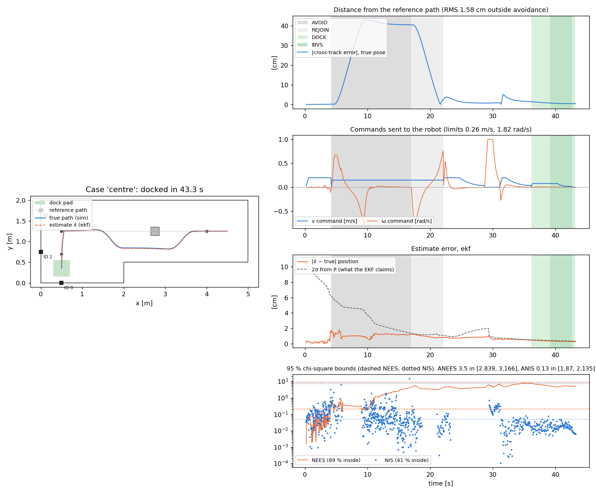
 
|   Case   | Docked | Time [s] | Cross-track RMS [cm] | RMSE [cm] | Dock lateral [cm] | Heading [deg] | Collisions | ANEES (95 % band) | NEES inside | ANIS | NIS inside |
| :--------| :------| :--------| :--------------------| :-------- | :-----------------| :-------------| :----------| :-----------------| :-----------| :----| :----------|
|   none   | Yes    | 37.4     | 1.01                 | 0.43      | +0.4              | -0.7          | None       | 2.61 [2.83, 3.18] | 88 %        | 0.10 | 46 %       |
|   left   | Yes    | 37.2     | 1.06                 | 0.58      | +0.4              | -0.7          | None       | 2.66 [2.83, 3.18] | 88 %        | 0.09 | 44 %       |
|   centre | Yes    | 43.3     | 1.58                 | 0.83      | +0.4              | -0.7          | None       | 3.50 [2.84, 3.17] | 89 %        | 0.13 | 41 %       |
|   right  | Yes    | 37.4     | 1.01                 | 0.43      | +0.4              | -0.7          | None       | 2.61 [2.83, 3.18] | 88 %        | 0.10 | 46 %       |

To summarise. The robot performs relatively well. As displayed by this simple pass/fail check from ([estimation_test.py](src/estimation/estimation_test.py)). Showcasing that it is able to reach its charging station, and pass every test.

-----------------------------------------------------------------------------------

PASS  baseline: the first encoder sample does not move the estimate

PASS  straight: equal wheel turns move 1 m along x, heading unchanged

PASS  turn: opposite wheel turns spin +90 deg on the spot

PASS  repeated encoder timestamp: no second prediction

PASS  wrap: 179 deg - (-179 deg) is -2 deg, not 358 deg

PASS  bearing residual is wrapped near +-180 deg   (bearing 1.57 deg)

PASS  F matches finite differences

PASS  H matches finite differences

PASS  missing data: empty markers dict leaves the estimate unchanged

PASS  missing data: unknown ID 7 leaves the estimate unchanged

PASS  missing data: nan measurement leaves the estimate unchanged

PASS  repeated frame: fused once only

PASS  old frame (1 s behind the encoders): not fused

PASS  correction: 11 cm / 3 deg off, markers 0 and 2 in view -> below 1 cm and 0.5 deg   (0.63 cm, 0.23 deg, 58/58 fused)

PASS  gate: a 1 m range outlier is rejected   (NIS 311)

PASS  1000 random steps: x_hat finite, P symmetric, eigenvalues >= 0   (min eig 1.9e-04)

PASS  config: by default the sim camera's ekf_noise replaces range bias, range sd and bearing sd   ({'range_bias_r2': 0.0045, 'range_sd': [0.00911, 0.00563], 'bearing_sd_deg': 0.0571})

PASS  config: the real camera's range_correction drops the sim bias (never subtracted twice)

**0 failed - all checks passed**

------------------------------------------------------------------------------------

### 4.4 Tuning trade-off: consistency vs responsiveness (R sweep) [D]

This runs a test to compare Consistency to Responsiveness. For this test, **R (EKF's measurement noise)** is tested across its 4 conditions. **R x10, R (config), R (measured bearing sd)**, and **R / 10**. 

To elaborate:

**Consistency** refers to whether the error matches the set uncertainty. If the real errors are above it, that being the ANEES, it's overconfident. Then, overly cautious if it's below the ANEES. Further helping prevent collisions, at the cost of the robot's speed.

**Responsiveness** refers to how fast the filter chases the measurements. A small R results in the filter reacting to every sighting, including noise. This results in more jitter. Whereas a large R results in a slower filter. This makes it slower to correct drift, but it is an overall smoother experience.

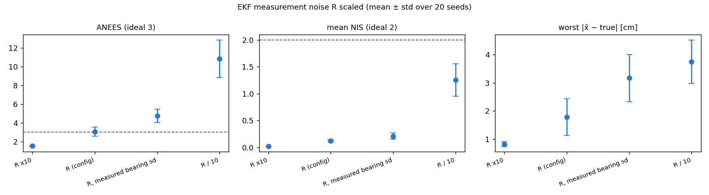

These test results are from ([sweep_r](evaluation/sweep_r.py)).

|R                      |	Docked | ANEES      |	NIS	|Gated|	Worst error [cm] |
| :-------------------- | :----- | :--------- | :-- | :-- | :--------------- |
|R x10	                |  100 % |1.54 ± 0.06	|0.02 |0.0  |	0.82 ± 0.08      |
|R (config)	            | 100 %	 |3.08 ± 0.49 |0.12 |0.2  |	1.78 ± 0.65      |
|R, measured bearing sd |	100 %	 |4.76 ± 0.70 |0.21 |0.6  |	3.17 ± 0.83      |
|R / 10	                | 100 %	 |10.85 ± 1.99|1.25 |12.0 |	3.75 ± 0.78      |

The table below is an expansion upon the data above. Analysing their consistency and responsiveness. Then concluding how that would impact the robot's performance on the track.

| R setting              | Consistency       | Responsiveness   | Verdict                      |
| :--------------------- | :---------------  | :--------------- | :--------------------------- | 
|    R X10               | too cautious      | Unresponsive     | staggent                     |
| R (config)             | consistent        | responsive       | slow but steady movement     |
| R, measured bearing sd | too confident     | responsive       | fast but unreliable movement |
| R / 10                 | overly confident  | Overly responsive| uncontrollable movement      |

When taking into account track A. Where the robot's main objective is to reach the charging station without any collisions. No matter the time taken. R (config) would make the most logical sense. For, whilst slower. Being aligned with consistency means that it will measure less noise and move smoothly. At the cost of speed, which isn't a requirement for this track.

As a result, **consistency succeeds reliability** for this track.

### 4.5 Comparison with a second estimator: EKF vs odometry only, same seeds [HD] 

This compares the EKF to odometry through 20 random tests. Observing through simulation if it could dock successfully

| Run | Docked | Contacts | Notes |
|---|---|---|---|
| EKF | 20 / 20 | 0 | 42.0 +- 1.9 s, dock lateral 0.23 +- 0.44 cm, yaw -0.37 +- 0.76 deg, ANEES 3.8; seed 5 (box beside the lane) used to stop `too_close` on its narrow side; the pass side is now the one needing the smaller sideways offset (`avoidance.py`) |
| Odometry only | 9 / 20 | 2 | the hidden placement and wheel errors are never corrected (estimate off by up to 74 cm) |

To expand upon this, ([run_demo](evaluation/run_demo.py)) was utilised to create a graph. This showcases how not only does the EKF have a higher docking rate, but also its errors are more consistently close to 0. In comparison to the odometry readings. With very inconsistent errors

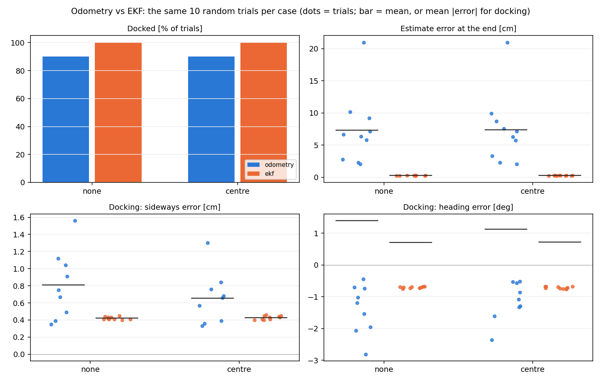

From these 2 points, it is made clear that the EKF outperforms the odometry as an estimator. Not only has a higher success rate of docking. But also produces fewer errors.


## 5. Control (D): controller design, tuning and tracking results
### 5.1 Controller design: LQR, turn and IBVS [D]
The robot switches between three controllers according to its mode. All three controllers use only EKF-estimated states or camera measurements (for IBVS), never the ground-truth pose.

| Mode | Controller | Command | Why this controller |
|---|---|---|---|
| Path following | Discrete LQR | ω = vκ − Kê | Balances tracking error against steering effort |
| Obstacle avoidance (LiDAR) | Same LQR, shifted line | ω = vκ − Kê, with e<sub>y</sub> → e<sub>y</sub> − d | No new controller: the reference is shifted by d and rejoined |
| Turning (corners > 30°) | P-controller | v = 0, ω = −k<sub>turn</sub>e<sub>θ</sub> | Allows the robot to rotate in place. At v = 0, the path-following model cannot control e<sub>y</sub> (rank C = 1, Section 2.2). |
| Docking (< 0.55 m from the marker) | IBVS | (v, ω) = λ J<sub>mr</sub><sup>+</sup>(p* − p) | Minimises the image-feature errors directly. |

**LQR (path following):** The LQR gain K is calculated from the discrete state-space model in Section 2.1 (ct.dlqr). It is combined with curvature feedforward and clipped to the motor limit:

$$\omega = v\kappa - K\hat e$$

At v = 0.20 m/s, the calculated gain is K = [9.16, 3.25], and the angular velocity is limited to |ω| ≤ 1.82 rad/s.

- **Stability check:** The closed-loop eigenvalue magnitudes are below 1 for both the straight path (0.965, 0.871) and a test arc of radius 0.5 m (0.960, 0.875). This confirms stability of the nominal linear model, while motor saturation, estimation errors and nonlinear dynamics are checked separately in simulation (Sections 2.4 and 5.3).
- **Approaching the dock:** After the pre-dock waypoint W3 (about 0.70 m from the marker), the LQR gain is recalculated at v<sub>dock</sub> = 0.08 m/s, which gives K = [9.25, 2.92]. It drives the robot until the marker is 0.55 m away, where IBVS takes over.
- **Why LQI is not used:** An LQI controller was also implemented in the code but disabled because the LQR already shows no large steady-state offset (mean cross-track error ≤ 0.83 cm, Section 5.4). Furthermore, LQI integrates the estimated cross-track error ê<sub>y</sub>, so it cannot reliably remove an offset caused by the estimation bias (Section 2.4).

**Obstacle avoidance:** When LiDAR detects an obstacle in the robot's path, the robot shifts its reference path sideways by an offset d to avoid it. The same LQR controller follows this shifted path using the modified cross-track error ê<sub>y</sub> − d. If neither side has enough clearance, or the LiDAR scan is invalid, the robot stops for safety (src/control/avoidance.py).

**Proportional turn (corners):** At a corner sharper than 30°, the robot stops and turns on the spot:

$$v = 0, \qquad \omega = -k_{turn}\, e_\theta$$

with k<sub>turn</sub> = 2.0 s⁻¹ and |ω| ≤ 1.0 rad/s. Control returns to the LQR once |e<sub>θ</sub>| < 3° (src/control/waypoints.py).

**IBVS (final docking):**

- **Switching:** The LQR first drives the robot onto the marker's normal, because IBVS alone may leave a unicycle facing the marker but offset sideways. IBVS takes over once the marker is less than 0.55 m from the robot and all four corners and a valid PnP pose are detected. However, the system does not verify the robot's alignment with the marker before switching, so perfect alignment is not guaranteed.
- **Control law:** IBVS uses the four marker corners to minimise image-feature errors:

  $$(v, \omega) = \lambda\, J_{mr}^{+}\,(p^* - p)$$

  with λ = 0.8 s⁻¹, |v| ≤ 0.08 m/s and |ω| ≤ 0.5 rad/s. Here p is the current positions of the four marker corners in the camera image, and p* is the desired positions when the robot is docked. J<sub>mr</sub> is the image Jacobian adapted to the robot's two control inputs (v, ω). The corner depths are estimated from the PnP pose in each frame.
- **Stopping:** IBVS ends at whichever comes first: the corner error falls below 1.5 px RMS, the camera-measured range reaches the stop range, the commands stay near zero for 1 s, or IBVS would command the robot backwards.

Docking is confirmed only after the SETTLE checks verify that the robot's docking position, heading, EKF uncertainty and wheel speed remain within tolerance for the required hold time. These checks use camera measurements and EKF estimates, never the true pose (src/control/visual_servo.py, src/control/docking.py).

**Interpretation:** LQR was chosen because it balances tracking errors and steering effort through the weighting matrices Q and R. Since our waypoint path consists mainly of straight segments (κ = 0), steering is primarily controlled by LQR feedback.

For obstacle avoidance, the same LQR follows a shifted reference path without requiring a new controller. The P-controller handles sharp turns in place, while IBVS handles the final docking by minimising image-feature errors. Together, the three controllers handle different operating conditions of the robot.

### 5.2 Tuning: weights, why, and what limits the gains [D]
**LQR tuning: where Q and R come from.** We used Bryson's rule to select the weighting matrices Q and R. Each tracking error and control input is weighted by the inverse square of its maximum acceptable value:

$$Q = \mathrm{diag}\left(\frac{1}{e_{y,max}^2}, \frac{1}{e_{\theta,max}^2}\right) = \mathrm{diag}\left(\frac{1}{0.05^2}, \frac{1}{0.1745^2}\right) = \mathrm{diag}(400,\ 32.8)$$

$$R = \frac{1}{\delta\omega_{max}^2} = \frac{1}{0.5^2} = 4$$

with e<sub>θ,max</sub> = 10° = 0.1745 rad. Q penalises the cross-track and heading errors, while R penalises the steering effort. The selected limits are justified below.

| Limit | Value | Why |
|---|---|---|
| e<sub>y,max</sub> | 0.05 m | Reduces the distance needed to correct a 20 cm offset from ~2.3 m (e<sub>y,max</sub> = 0.10 m), longer than the 1.6 m between W1 and W2, to ~1.2 m (src/control/lqr.py, design_weights). |
| e<sub>θ,max</sub> | 10° | Limits heading errors to help keep the docking marker visible in the camera |
| δω<sub>max</sub> | 0.5 rad/s | Limits steering effort to avoid overly aggressive corrections, well below the 1.82 rad/s motor limit |

**LQR: what limits the gains.**

1. **Motor saturation:** For a 20 cm lateral offset with zero heading error on a straight path, the calculated unsaturated LQR command is 1.83 rad/s, slightly above the Waffle Pi's 1.82 rad/s maximum angular velocity. The steering command is therefore clipped (Section 2.4).
2. **Estimation noise:** LQR uses tracking errors estimated by the EKF. Higher gains make the steering command more sensitive to the estimation noise. In our tests, higher gains were also associated with a slightly lower NEES pass rate (Section 5.4).
3. **Forward speed:** LQR corrects cross-track error more slowly at lower speed. In Section 2.4, the cross-track error e<sub>y</sub> takes 3.2 s to decay at v = 0.10 m/s, compared with 0.92 s at 0.26 m/s. Therefore, sharp corners are handled by the P-controller, which rotates the robot in place at v = 0, rather than using the path-following LQR at low speeds.

**P-turn parameters:** The proportional gain is k<sub>turn</sub> = 2.0 s⁻¹. The angular velocity is limited to 1.0 rad/s and the angular acceleration is limited to 2 rad/s². These limits prevent the robot from turning aggressively and keep the angular velocity below the motor's limit of 1.82 rad/s.

**IBVS parameters:** The gain is λ = 0.8 to provide gradual correction of image-feature errors without reacting too aggressively to camera noise.

### 5.3 Tracking Results in Simulation [D]
This section evaluates how accurately the LQR makes the robot follow the path and how effectively IBVS performs docking. The controllers use only the estimated states and the camera measurements, while the ground-truth pose is used to evaluate their performance.

**Path tracking: how accurately does LQR follow the path?**

| Run | Box | Docked | Cross-track RMS | Dock lateral error | Source |
|---|---|---|---|---|---|
| None | none | Yes (37.4 s) | 1.01 cm | 0.43 cm | [demo_metrics_ekf.json](results/demo_metrics_ekf.json) |
| Left | left of lane | Yes (37.2 s) | 1.06 cm | 0.43 cm | [demo_metrics_ekf.json](results/demo_metrics_ekf.json) |
| Right | right of lane | Yes (37.4 s) | 1.01 cm | 0.43 cm | [demo_metrics_ekf.json](results/demo_metrics_ekf.json) |
| Centre | in the lane | Yes (43.1 s) | 1.7 cm (outside avoidance) | 0.45 cm | [a3style_centre.npz](results/a3style_centre.npz) |

All four cases were run on the final code with the EKF in the loop (seed 0).

<p align="center">
  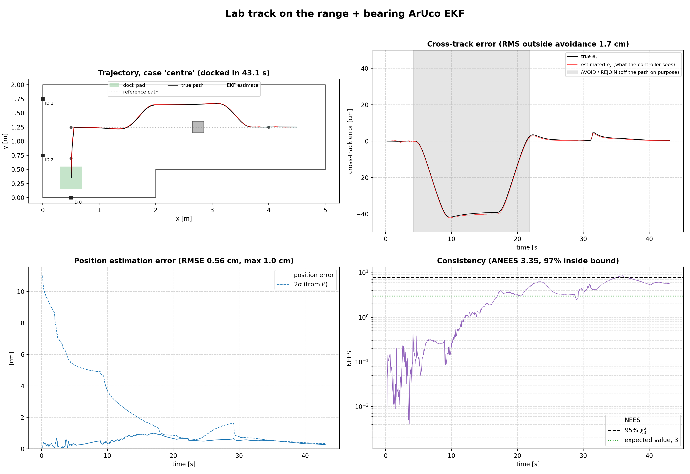
  <br><em>Figure 5.3a: Centre case: robot trajectory and reference path (top left), true and estimated cross-track errors (top right), and EKF estimation results (bottom, discussed in Section 4.3).</em>
</p>

**Results:** In the none, left and right cases, the box did not completely block the lane, so the robot stayed on the path and the LQR maintained the cross-track RMS at 1.0–1.1 cm. In the centre case, the box blocked the lane, and the robot had to avoid it. The cross-track RMS was 1.7 cm (excluding the avoidance process). This slightly higher value likely came from rejoining the original track after avoiding the box (top right, Figure 5.3a, after about 22 s).

During obstacle avoidance, the robot intentionally moved about 40 cm away from the original path to pass the box, as shown by the shaded region (top right, Figure 5.3a). This deviation is intentional rather than a failure of LQR tracking, because the controller follows a laterally shifted reference path during obstacle avoidance and then drives the robot back to the original path.

The estimated cross-track error closely followed the true error (top right, Figure 5.3a), supporting the use of EKF estimates for LQR feedback in this run.

**Docking: does IBVS improve docking performance?**

| Controller | Docked | Lateral error | Yaw error | Docking time |
|---|---|---|---|---|
| PBVS | 10/10 | 0.26 ± 0.45 cm | −0.4 ± 0.7° | 8.25 s |
| IBVS | 10/10 | 0.26 ± 0.45 cm | −0.4 ± 0.7° | 7.10 s |

Source: [ibvs_docking.json](results/ibvs_docking.json).

<p align="center">
  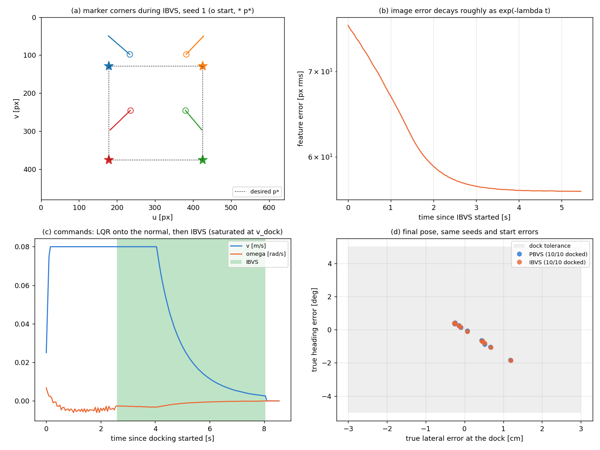
  <br><em>Figure 5.3b: IBVS docking: (a) marker corner movement towards the desired image positions; (b) image-feature error during IBVS; (c) control commands during the LQR-to-IBVS transition; and (d) final docking errors of IBVS and PBVS.</em>
</p>

**Results:** The centre case successfully docked with a lateral error of 0.45 cm. To compare docking performance, IBVS and PBVS were tested using the same 10 random seeds with hidden placement errors.

Both controllers successfully docked in all 10 trials, with almost identical final lateral and heading errors. However, IBVS completed docking 1.15 s faster on average (7.10 s compared with PBVS's 8.25 s).

The image-feature errors decreased from approximately 93 to 57 px, but IBVS stopped when the robot reached a camera-based stopping distance, before the image-feature error reached the 1.5 px tolerance (Figure 5.3b). This suggests the final docking accuracy also depended on the earlier LQR alignment and the camera-based stopping distance.

Overall, IBVS reduced docking time in these 10 tests but did not show a measurable improvement in the final docking accuracy. Under the randomised 20 runs, the system also achieved 20/20 successful dockings (Section 6.1).

### 5.4 Tuning trade-off: control effort vs tracking error [D]
The LQR weight R was tested at three values with Q fixed: R = 40, R = 4 (chosen) and R = 0.4. Each value was tested on the centre case with 20 seeds, each seed adding a random initial position and encoder-scale error, with LQR using EKF-estimated states for feedback rather than ground truth. All 60 runs completed docking successfully. Cross-track errors were evaluated using the ground-truth pose, while control effort was evaluated using the steering commands. The tracking and steering metrics include only LQR path-tracking periods, while docking success and the NEES share are computed over the whole run (evaluation/sweep_lqr.py).

| R | Cross-track RMS | Steady offset | RMS feedback steering | NEES ≤ 7.81 | Command rate |
|---|---|---|---|---|---|
| 40 | 3.13 cm | +0.36 cm | 0.098 rad/s | 96 % | 0.28 rad/s² |
| 4 (chosen) | 1.73 cm | +0.57 cm | 0.077 rad/s | 96 % | 0.38 rad/s² |
| 0.4 | 1.42 cm | +0.83 cm | 0.070 rad/s | 93 % | 0.57 rad/s² |

Source: [sweep_lqr.json](results/sweep_lqr.json).

<p align="center">
  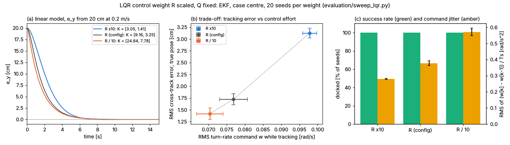
  <br><em>Figure 5.4: LQR weight sweep. R x10, R (config) and R / 10 correspond to R = 40, 4 and 0.4. (a) Linear-model response to a 20 cm offset at 0.2 m/s, with the resulting gains K. (b) Cross-track error against steering effort; error bars show the spread over seeds. (c) Docking success rate (green) and RMS rate of change of the angular velocity command (amber).</em>
</p>

**Interpretation:**

**1. How did R affect tracking?** Reducing R places less penalty on control effort, allowing LQR to correct cross-track errors more aggressively. The feedback gain increased (K = [3.05, 1.41], [9.16, 3.25] and [24.84, 7.78]) and errors are corrected faster (Figure 5.4a). The cross-track RMS fell from 3.13 cm at R = 40 to 1.73 cm at R = 4. However, reducing R by another factor of 10, from 4 to 0.4, decreased cross-track RMS error by only 0.31 cm.

**2. What did the higher gain cost?** At R = 0.4, the command rate increased from 0.38 to 0.57 rad/s², indicating less smooth steering (Figure 5.4c). The percentage of NEES samples below 7.81 also fell from 96 % to 93 %.

Meanwhile, RMS feedback steering decreased slightly from 0.077 to 0.070 rad/s. Although the steering commands had a lower RMS magnitude, they changed more rapidly. The higher gain therefore improved tracking accuracy at the cost of steering smoothness.

**3. Why R = 4?** All three R values docked in every run. However, R = 40 produced a much higher cross-track RMS error (3.13 cm) than R = 4 (1.73 cm). Reducing R from 4 to 0.4 improved the cross-track RMS error by only 0.31 cm, while increasing the command rate from 0.38 to 0.57 rad/s². R = 4 therefore provided a better balance between tracking accuracy and steering smoothness.

**4. What remains uncertain?** The steady-state offset increased from +0.36 to +0.83 cm as R decreased. Although reducing R improved the cross-track RMS error, it did not reduce the steady-state offset. The reason for this behaviour was not determined.

The weight sweep also kept Q fixed to isolate the effect of R, so the effect of changing Q was not evaluated.

## 6. Integration and Robustness (E): performance under disturbance and noise

### 6.1 Performance under disturbance and noise [D]

This section tests whether the complete system can still navigate and dock when the starting position, the obstacle location and the sensor measurements vary. Twenty randomised scenarios were tested using both EKF and wheel odometry alone.

Each of the 20 randomised scenarios (seeds 1–20) varied two types of conditions: those known to the robot and those hidden from it ([random_trials.py](evaluation/random_trials.py), [scenario.py](src/robot/scenario.py)).

- **Known to the robot:** The initial position estimate provided to the EKF and the planned route (W1 and W2)
- **Hidden from the robot:**
  - Initial placement error: Random placement error (0.9-10.6 cm, up to 10°), sampled from N (0, P₀) and clipped at 2σ.
  - The box position: Randomly placed within the lane.
  - LiDAR noise: Noise scaled by 1–2, with 1–5% dropout.
  - Camera noise: Gaussian intensity noise added to every pixel (SD 2–4 grey levels)
  - Encoder-scale error: Up to ±1% per wheel.

The robot only uses sensor measurements and estimated states. Ground-truth pose is used only for performance evaluation.

A run is considered completed when the docking check passes. It is considered a docking success only if the docking check passes, the final ground-truth position and heading errors are within 3 cm and 5°, respectively, and no collision occurs with the walls or obstacle box.

| Condition | Trials | Completed | Docking success | Runs with contact | Notes | Source |
|---|---|---|---|---|---|---|
| Nominal, 4 box cases (none, left, centre, right) | 4 (1 per case) | 4/4 | 4/4 | 0/4 | 37.2–43.1 s<br>Docking lateral error: 0.43–0.45 cm | [demo_metrics_ekf.json](results/demo_metrics_ekf.json) |
| Disturbed, EKF | 20 | 20/20 | 20/20 | 0/20 | 42.0 ± 1.9 s<br>Docking lateral position error: 0.23 ± 0.44 cm<br>Docking heading error: −0.37 ± 0.76° | [random_trials.json](results/random_trials.json) |
| Disturbed, odometry only | 20 | 9/20 | 9/20 | 2/20 | Estimate error at the end 33.7 ± 21.9 cm (max: 74 cm) | [random_trials_odometry.json](results/random_trials_odometry.json) |

These trials evaluated the robustness of the complete system under multiple random disturbances. However, they did not isolate the individual effect of each disturbance.

<p align="center">
  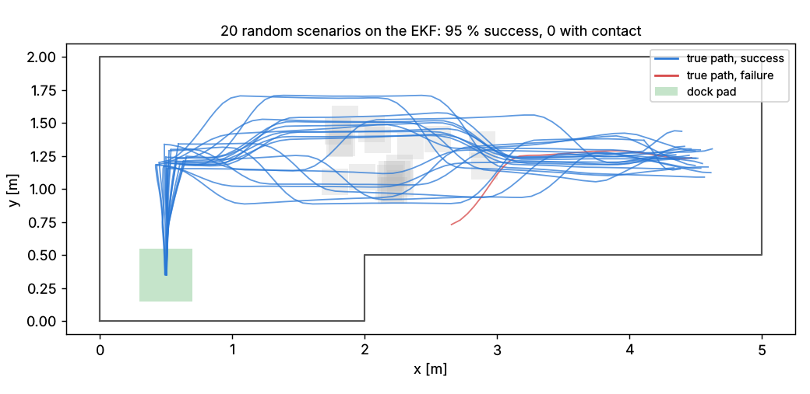
  <br><em>Figure 6.1a: True paths of the 20 randomised trials with the EKF.</em>
</p>

<p align="center">
  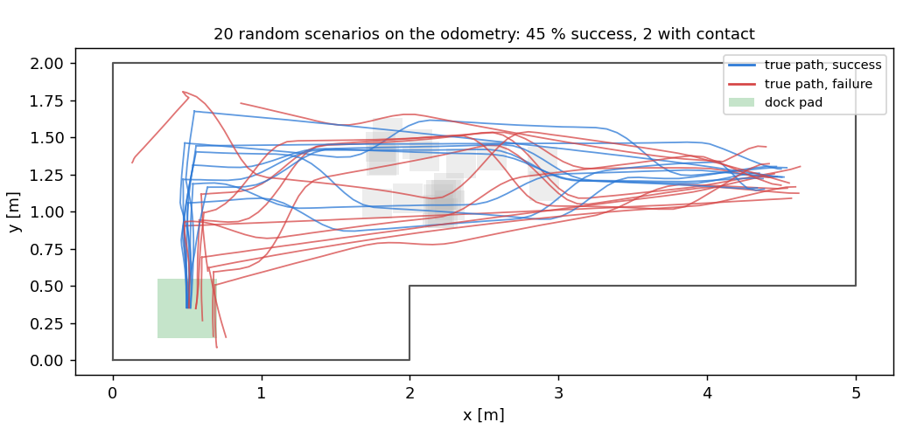
  <br><em>Figure 6.1b: The same 20 seeds steered on wheel odometry only.</em>
</p>

**Results:**

All four nominal runs (none, left, right and centre box cases) docked successfully without collision, confirming that the system worked under nominal conditions.

With EKF, all 20 random runs docked successfully without collision. The mean docking lateral error was 0.23 cm, with a standard deviation of 0.44 cm across the 20 trials. The maximum position estimation error during these trials was 10.9 cm (seed 14, with a 7.8 cm initial placement error). However, the error decreased to below 0.4 cm by the end of every run, as marker measurements helped correct the position estimates.

In contrast, with wheel odometry alone, only 9 of the same 20 runs completed docking and two runs had collision. Without marker-based corrections, the initial placement error remained uncorrected, while small errors in the wheel encoder measurements accumulated as the robot moved. As a result, the position estimation error reached up to 74 cm.

**Why it looks this way:** The main difference between the 20 EKF and odometry-only runs was the accuracy of their position estimates. Marker measurements helped EKF correct accumulated estimation errors, allowing the robot to follow the planned route accurately and complete docking reliably under multiple random disturbances.

### 6.2 Failure analysis traced to model, sensing, estimator or controller [D]

The observed failures and safety stops were investigated using the simulation ground truth and the real-robot sensor logs to identify their most likely causes. This section presents an analysis of failures and safety stops observed in the final tests, problems identified and fixed during development and remaining limitations.

#### A. Failures and safety stops observed in the final tests

| Observed issue          | Source                    | Evidence                                                                                        | Primary cause         |
|-------------------------|---------------------------|-------------------------------------------------------------------------------------------------|-----------------------|
| Odometry drift          | Simulation, odometry only | 11/20 failed; position estimation error: 20–74 cm                                               | Estimator             |
| Displaced marker        | Real robot                | 30 measurements rejected by the NIS gate; `marker_lost` stop                                    | Sensing / environment |
| Low LiDAR scan coverage | Real robot                | Forward scan coverage 0.34–0.55, below the required threshold of 0.8; robot waited at the start | Sensing               |

**1. Odometry drift (estimator):** Using the same 20 random seeds, all 20 runs with EKF completed the task successfully, compared with only 9 out of 20 odometry-only runs. In the 11 failed odometry-only runs, the position estimation error ranged from 20 to 74 cm at the pre-dock point. These estimation errors led to three different stop reasons:

| Stop reason   | Runs (seeds)            | What happened                                                                                                                                                                                                                                              |
|---------------|-------------------------|------------------------------------------------------------------------------------------------------------------------------------------------------------------------------------------------------------------------------------------------------------|
| `marker_lost` | 6 (2, 5, 7, 13, 15, 19) | The docking marker was outside the camera view, so the robot waited and then gave up. Seeds 2 and 19 also collided with a corridor wall.                                                                                                                   |
| `not_docked`  | 4 (3, 4, 18, 20)        | The final docking check failed because the robot relied on the estimated pose. In seeds 4 and 18, the robot’s ground-truth pose was within 1.6 cm and 2.0° of the goal, but its position estimate was 24–31 cm away from the true position                 |
| `too_close`   | 1 (14)                  | The position estimation error reached 66cm on the long straight path. Because the robot used these incorrect estimated poses, it moved away from its planned path. Then, the LiDAR safety check detected an obstacle directly ahead and stopped the robot. |

The comparison between EKF and odometry-only runs showed that accumulated position estimation errors were the primary cause of the odometry-only failures. Depending on the run, these errors caused the robot to lose sight of the docking marker, fail the final docking check or trigger the LiDAR safety stop.

**2. Displaced marker (sensing / environment):** Marker 0 was moved from its designated position, causing the camera measurements to become inconsistent with the EKF predictions. The NIS gate rejected 30 measurements from Marker 0, while measurements from Markers 1 and 2 were still accepted. This prevented the EKF from updating its position estimate using the inconsistent measurements from Marker 0. During the test, the robot stopped docking and reported `marker_lost` as the reason. The recommended solution is to check the marker positions before each run.

**3. Low LiDAR scan coverage (sensing):** During real-robot testing on 28 October, the forward LiDAR scan coverage was only 0.34-0.55, compared with 0.88-1.00 in simulation. This was likely because the LDS-01 received too few valid measurements from the black foam panels forming the corridor walls.

Because the scan coverage was below the required threshold of 0.8, the robot remained at its starting position. The threshold was then reduced to 0.2 for real-robot operation. In subsequent tests, the robot showed multiple successful runs with LiDAR being able to detect obstacles and trigger AVOID state.

#### B. Failures identified and fixed during development

These problems were identified and addressed during development, before the final trials reported in Section 6.1.

| Earlier problem                                                                  | Primary Cause                                                                                             | Fix                                                                                                                                         |
|----------------------------------------------------------------------------------|-----------------------------------------------------------------------------------------------------------|---------------------------------------------------------------------------------------------------------------------------------------------|
| EKF rejected marker measurements when the initial position was 11 cm off         | Estimator: initial covariance P0 too small (2 cm / 2° initial standard deviations), causing NIS rejection | Increased the EKF's initial position and heading uncertainty to 5 cm / 5° and generated random placement errors consistent with the new P0. |
| Robot collided with the box corner when returning to the path (3/10 tested runs) | Controller: avoidance clearance too small (0.05 m)                                                        | Increased avoidance clearance to 0.10 m. All 20 subsequent runs completed the task successfully.                                            |
| Robot selected the narrower side when avoiding a box (too_close, seed 5)         | Controller: Incorrect obstacle avoidance side selection                                                   | Changed the obstacle avoidance logic to select the side requiring less sideways movement ([avoidance.py](src/control/avoidance.py))         |

#### C. Remaining limitations

- **Model mismatch not confirmed:** No failures in the final trials were directly linked to differences between the mathematical model and the real robot's behaviour. Small docking errors remained in the nominal runs, but their causes were not determined. The limitations of the linear model are discussed in Section 2.4.
- **Lower LiDAR coverage threshold not re-tested:** The threshold was reduced from 0.8 to 0.2 to allow the robot to operate despite the low LiDAR scan coverage caused by the black foam panels. Previously, the robot required at least 80% valid scan coverage to move, but after the change, only 20% was required. Although this allowed the robot to operate, it also meant that the robot could continue moving with less valid LiDAR data. The system was not re-tested with a blocked or faulty LiDAR, so its safety under these conditions remains unverified.

## 7. Real Robot
### 7.1 Setup and differences from simulation [HD-hw]
We tested the system using a TurtleBot3 Waffle Pi that running ROS 2, with an LDS-01 LiDAR and a Pi camera. Our laptop receives sensor data and sends velocity commands over the lab wifi and through the rosbeidge (UTS-RI rosbridge_api). The real robot ([real_robot.py](src/robot/real_robot.py)) provide the sensor reading and command function as the simulation, allowing the EKF, controllers, and mission logic to run on both platforms with the same logic. Wheel joint data from /joint_states is used to calculate odometry, camera images are used to detect ArUco markers, LiDAR data from /scan is used for obstacle avoidance. 

The laptop can control linear, angular velocity of the robot through /cmd_vel. 
The real rrack contained three 100 mm ArUco markers and a 20cm box (obstacle). 

The run command is python main.py --real --task config/arena_lab.json. 

<p align="center">
  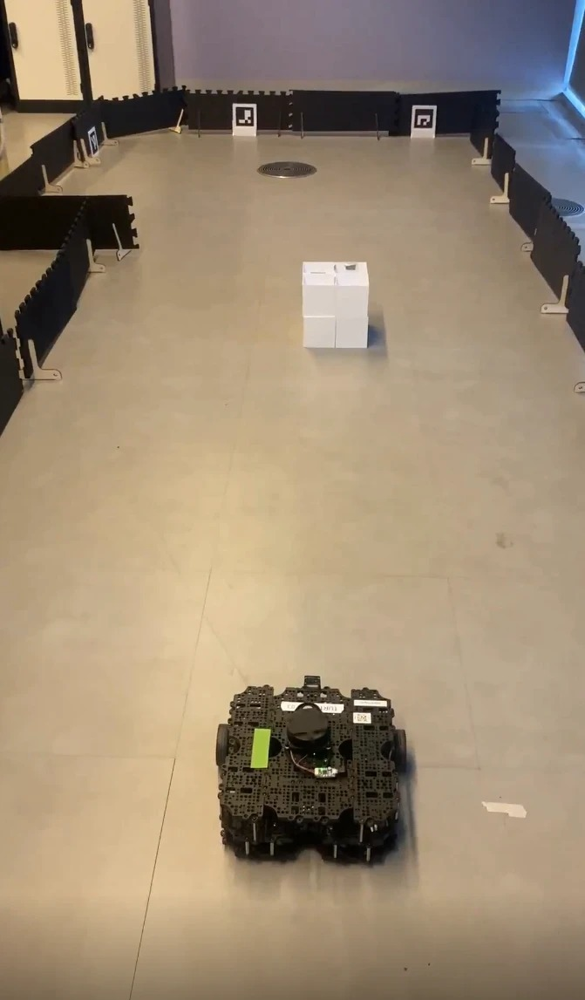
  <br><em>The real robot is on its start mark, marker 1 and 2 on the front wall with the obstacle (box) in the driving lane.</em>
</p>


| Setting | Simulation | Real robot | Why the different| 
|---|---|---|---|
|Speed limits| Linear: 0.26 m/s / Angular: 1.82 rad/s | Linear: 0.1 m/s / Angular: 1.0 rad/s|  Lower speeds on real robot were used to improve marker detection and control reliability by reducing motion blure and communication delays' effect|
|Minimum valid LiDAR forward coverage| 80% | 20% | Real LiDAR can not receive many returns from every surface. the return quality depends on different factor, as material, distance. In our test black foam panels even produced few returns|
|Docking state| v: 0.8 m/s/ Lateral tolerance: 3 cm/ Heading Tolerance: 5°|v: 0.05 m/s/ Lateral tolerance: 4 cm/ Heading Tolerance: 8°, stop 1.5 cm early| The real robot move more slowly and stop early to reduce overshoot at the docking position. Wider tolerances allow for localisation and control errors observed during hardware calibration| 
|Avoidance clearance| 0.1 m, side margin 0.05 m | 0.08 m, side margin 0.03 m| Smaller clearance and side margins allow the planned avoidance path to fit within the lab narrower real corridor| 
### 7.2 Real-robot results with the same metrics: tracking (D), docking (D), number of runs under real noise (E) [HD-hw]

**Real-robot trials** We filmed 9 full tracks runs on 30 October. In three runs, the box was centred in the lane. In the other sex, it was shifeted 15 cm left or right. 

The real robot also drive without external ground truth system using EKF during track mode. Therefore, the real distance error between the robot and track was not independently verified. For six successful docks, we measure the robot's final position and heading to compare it with simulation environment.

| Run | Box position | Outcome | Run time | Estimated cross-track RMS during TRACK | Marker measurements accepted |
|---|---|---|---|---|---|
| 09:28 | Centre | Docked | 62.4 s | 1.9 cm | 96% |
| 09:32 | Centre | Docked | 62.2 s | 2.4 cm | 95% |
| 09:36 | Centre | Docked | 62.3 s | 2.1 cm | 98% |
| 09:40 | Right | marker_lost | 53.5 s | 1.7 cm | 93% |
| 09:41 | Right | marker_lost | 53.3 s | 1.2 cm | 93% |
| 09:43 | Left | marker_lost | 56.4 s | 2.6 cm | 83% |
| 10:48 | Right | Docked | 60.8 s | 1.4 cm | 96% |
| 10:54 | Right | Docked | 61.8 s | 1.4 cm | 96% |
| 10:59 | Left | Docked | 61.5 s | 1.7 cm | 99% |

The three unsucessful runs (9:40-9:43) occuring during the final approach, where the side markers were all out of view and the EKF relied completely on wheel odometry. The robot caught on a raised floor vent coer, causing turing motion stuck. Therefore, the estimated pose become inaccurate, and as a result dock-marker measurement were missing or rejected by the NIS gate. The robot than stopped safel

After the track was moved away from the vent cover, the next three runs docked without code changes.This support that the NIS helps protect the estimate from bad measurements, but when the estimate is wrong, it cannot recover it self without any visible markers

### 7.3 Quantitative simulation vs real comparison [HD-hw]
The below table show the different between the simulation and real robot docking stage. 
| Metric (5 measured hardware docks and their simulation counterparts) | Simulation | Real robot |
|---|---|---|
| Final distance to dock marker — target: 35 cm | 36.55 ± 0.03 cm | 35.35 ± 0.25 cm |
| Lateral docking error | +0.46 ± 0.02 cm | +0.52 ± 0.35 cm |
| Heading docking error | −0.77 ± 0.03° | −0.65 ± 1.11° |
| Completion time | 43.8–44.9 s | Approximately 61–62 s |

Both system used a 35 cm taget distance and were both set to stop 1.5 cm early, at about36.5 cm from the marker. While the simulation stopped at 36.55 cm near to the intended value, the real robot stopped at 35.35 cm. Proving that there is a chance real robot still moving after docking complete. The real robot took longer to finish as the it interface limits speed to 0.10 m/s, while the simulation uses speed of 0.2 m/s


## 8. Independent Contribution Summary (only list what has results) Core (needed):
### 8.1 Real-robot implementation (section 7): HD evidence for B, D, E [HD-hw]
### 8.2 Model limits (2.4) and limitations (9.1): HD evidence for A [HD]
### 8.3 Second estimator comparison (4.5): HD evidence for C. Cheapest option: the odometry-only mode already exists, it just needs a proper re-run [HD]

## 9. Limitations and Lessons
### 9.1 What the results do and do not support [HD]

Will get back to this

### 9.2 What failed during development, and how it was diagnosed [D]

When the team was stuck with a problem. We would utilise AI to help break the problem down, and help guide us in the right direction. Acting almost as a tutor.

For example, when it came to writing the estimation section of the report. AI was utilised to help lay out a general outline of what needed to be done, and how. Narrowing down on a section when there was confusion.

## 10. Reproducibility
### 10.1 Install and run from a fresh environment [D]

You need **Python 3.10** (64-bit) and **Git**. Each member creates their own virtual environment
`.venv_mujoco` inside the project folder; it is never committed.

##### Linux (Ubuntu)

```bash
git clone https://github.com/Atomic-add/IntegratedProject_SensorsAndControlsForMechatronicSystems_SPR2026.git
cd IntegratedProject_SensorsAndControlsForMechatronicSystems_SPR2026
python3.10 -m venv .venv_mujoco            # Ubuntu: sudo apt install python3.10-venv if this fails
source .venv_mujoco/bin/activate
python -m pip install --upgrade pip
python -m pip uninstall -y opencv-python  # only matters if it was installed before ("Skipping" is fine)
python -m pip install -r requirements.txt
```

##### Windows (PowerShell)

```powershell
git clone https://github.com/Atomic-add/IntegratedProject_SensorsAndControlsForMechatronicSystems_SPR2026.git
cd IntegratedProject_SensorsAndControlsForMechatronicSystems_SPR2026
py -3.10 -m venv .venv_mujoco
.\.venv_mujoco\Scripts\Activate.ps1
python -m pip install --upgrade pip
python -m pip uninstall -y opencv-python
python -m pip install -r requirements.txt
```

If PowerShell blocks `Activate.ps1`, skip activation and call the environment's Python directly,
e.g. `.\.venv_mujoco\Scripts\python.exe main.py`. More detail: `mujoco_installation_guide/`.

##### Check the installation

```bash
python -c "import sys, mujoco, cv2; print(sys.version.split()[0], mujoco.__version__, cv2.__version__)"
```

Expected: `3.10.x 3.15.0 4.10.0`.

`requirements.txt` pins every package (cp310 wheels exist for Windows and Linux):
mujoco 3.15.0, numpy 2.2.6, scipy 1.15.3, matplotlib 3.10.9, spatialmath-python 1.1.18,
opencv-contrib-python 4.10.0.84 (the Week 3 pin). Never install `opencv-python` next to it: both
provide `cv2` and break each other. After a `git pull` that changes `requirements.txt`, run the
install line again.

**Every time** you open a new terminal: go to the project folder and activate the environment
(`source .venv_mujoco/bin/activate` or `.\.venv_mujoco\Scripts\Activate.ps1`).

### 9.2 Commands that regenerate each figure and table [D]

```bash
python -m evaluation.run_demo                # everything: 4 cases on odometry and on the EKF, repeated trials, comparison
python -m evaluation.run_demo centre --ekf   # one case on the EKF -> results/demo_centre_ekf.png
python -m evaluation.random_trials --n 20    # 20 random scenarios on the EKF -> results/random_trials.png/.json
python -m evaluation.random_trials --n 20 --odometry   # the same 20 on odometry only
python -m evaluation.sweep_r --n 20          # R x10, x1, /10: NEES, NIS, error -> results/sweep_r.png/.json
python -m evaluation.marker_layout           # where the lab landmarks go: markers in view + EKF replay -> results/marker_layout.*
python -m evaluation.consistency_sweep       # Qd x Rn grid on recorded lab runs: ANEES, ANIS, 2-sigma coverage -> results/consistency_*.*
python -m evaluation.plot_like_a3          # Assessment 3 style: EKF error +-2 sigma, 2x2 summary, sim and real clips -> results/ekf_*, real_anim_*
python -m evaluation.observability          # rank / Gramian per marker case, P growth with no marker, rank along the path -> results/observability.*
python -m evaluation.sweep_lqr --n 20       # LQR weight R x10, x1, /10 on the EKF: tracking error vs effort -> results/sweep_lqr.*
python -m evaluation.model_limits --n 20    # fixed K: |eig| vs speed, linear vs nonlinear, mission at 0.10/0.20/0.26 m/s -> results/model_limits.*
```

Figures and metrics go to `results/` (`demo_*.png`, `demo_metrics*.json`, `demo_trials_*.json`,
`demo_compare.*`). An EKF run takes about 2 min on a machine without a GPU, because rendering the
camera dominates; odometry-only runs take about 20 s. The trial scripts run `--workers 4` sims at a time
(`evaluation/__init__.py`): one per core renders 20 cameras at once and freezes a laptop.

### 9.3 Ground-truth rule: truth is read only in evaluation/ [D]

The controller must use the estimated state, never the ground truth. Ground truth can only be read in evaluation/


## 10. Team and Declarations (required; a missing item caps the affected criteria at Pass)
### 10.1 Group number and team members

- Addison Possamai (25840164)
- Nguyen Kim Uyen Phan (25596519)
- Nhat Thien Mai (25161391)

### 10.2 Individual contribution statement

#### Contribution table
|   Task                             | Person          |
| :--------------------------------- | :-------------- |
|    Overview                        | Addison + Kim   | 
|    Modelling (A)                   | Kim             | 
|    Sensing (B)                     | Thien           | 
|    Estimation (C)                  | Addison         | 
|    Control (D)                     | Kim             | 
|    Integration and Robustness (E)  | Kim             | 
|    Real Robot                      | Thien           |
|    Limitations and Lessons         | Addison         | 
|    Reproducibility                 | Addison         | 

#### Addison's  statement
I was assigned the estimation section of the project for the robot. With Kim helping me, as part of her Control section. After that, I was responsible for organising the project page. Getting everything up. As well as helping to organise hardware access for the team.

#### Kim's statement


#### Thien's statement


### 10.3 Generative AI declaration: tools and purpose

**Claude (Anthropic)** was used to scaffold the simulation environment, the sensor models and their checks; see the project page's GenAI declaration. In addition to this, it was also utilised to help guide the development of the project page. Not only outlining what needs to be done, and how, simply. It assisted in turning data outputs into tables. Improving their readability for the project page.

### 10.4 Acknowledgements: tutorial code, Assessment 2/3 code reused, ROBOTIS model, MuJoCo examples

- Robot model and meshes: [ROBOTIS robotis_mujoco_menagerie](https://github.com/ROBOTIS-GIT/robotis_mujoco_menagerie),
  Apache-2.0 (`models/robotis_tb3/LICENSE`); sensor poses from ROBOTIS `turtlebot3_waffle_pi.urdf`.
- Code adapted from the 41014 Week 2-9 tutorial solutions (cited in each module's docstring).
- Real-robot link: [UTS-RI/turtlebot_rosbridge](https://github.com/UTS-RI/turtlebot_rosbridge) (`rosbridge_api`,
  MIT), used unmodified; `src/robot/real_robot.py` hooks its message callbacks to keep arrival times.


